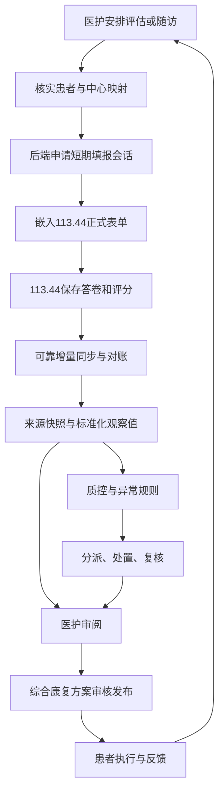
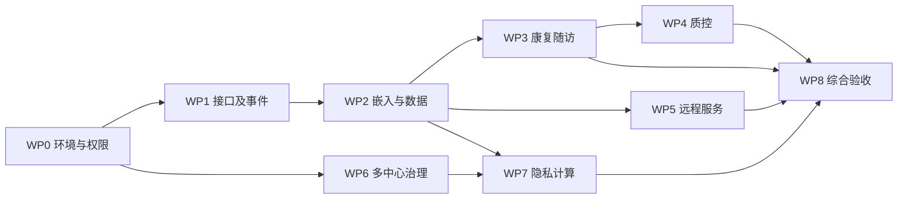

# 肾脏康复平台开发计划

- 制定日期：2026-11-07（Asia/Singapore）
- 状态：开发计划草案；已确认架构方向，临床与机构决策尚待确认。
- medicalassistant 基线：`f25ffa9388045786a40183b075ea4276bf1daf74`。
- 计划范围：113.44 表单嵌入和接入、综合康复管理、肾脏 ICF 与质控、远程随访、多中心协作、联邦学习和同态加密。
- 当前状态：BASE01—BASE03（集合与 schema 收敛）、AUTH01（康复/设备/统计域对象级授权）已实质推进；WS01、FU01、EMB01 隔离试点及 113.44 侧 API03 部分推进；WS01 契约冻结未做，FU01-S2 与 WS03 read_receipt 工作区在途未提交。逐项完成标准对照见 §9 交付记录，当前待决策见 §10。运行和验证记录见[基线核查记录](./baseline-2026-11-07.md)，不代表功能已上线或完成临床验证。
- 身份契约：[113.44与medicalassistant统一身份及授权契约草案](./identity-integration-contract.md)；接口、单点登录、嵌入和跨平台撤权尚未实现。
- 设备前置评估：[Joeme Fit / Veepoo SDK接入评估](./device-sdk-assessment-2026-11-07.md)；当前仅核查原生SDK文档，没有真实设备验证。
- 用户已确认首期设备目标为 JMD-540 和 Android；固件版本、支持指标与实机结果待确认。
- 用户确认 113.44 现阶段仅有医护账号、患者本人尚未与项目档案关联；首次联调使用隔离测试账号和测试患者，目标为医护嵌入填表与答卷状态回传。113.44 当前无 HTTPS，两端正式处理账号凭据或患者数据前须建立并验证安全传输及授权边界；该联调尚未实现。
- 用户确认：项目或中心权限被撤销、成员被停用后，即便后来重新授权或启用，先前的填报链接与委托也永久失效，必须重新发起。授权代际机制尚未上线，不能把此决定视为已生效的线上能力。
- 账号安全基础已开始收紧：公开注册不得提交权限或账号状态，普通启动不自动创建演示用户，个人资料页不再模拟修改成功；统一身份接入和历史账号处置仍未完成。隔离演示用法见[说明](./isolated-demo-accounts.md)。
- 康复方案前置核查：[康复方案链路核查](./rehabilitation-contract-review-2026-11-07.md)；现有路由、领域模型和执行统计尚未形成安全闭环。

## 1. 已确认方向与设计约束

A01—A05、A07—A08来自本轮已确认的产品方向；A06是为保证来源可追溯而提出的架构设计约束。

| 编号 | 决策 | 实施含义 |
|---|---|---|
| A01 | 表单统一在 113.44 创建和维护 | 表单定义、题目、量表、评分、原始答卷与版本由表单平台负责；medicalassistant 不再维护平行的表单定义和评分引擎 |
| A02 | 表单嵌入 medicalassistant 页面 | 113.44 提供受控嵌入入口；两端实现身份和资源授权，完成移动浏览器验收 |
| A03 | medicalassistant 负责康复业务 | 负责患者业务档案、方案、随访任务、医护待办、质控、预警和结果展示 |
| A04 | 首期包含多中心及隐私计算 | 多中心、联邦学习、同态加密属于本期必须交付的独立工作包，不降为远期愿景 |
| A05 | 以既有肾病项目起步 | 复用已授权、已发布的正式表单；具体基线、复评、随访版本由临床负责人确认 |
| A06 | 保留业务来源和历史 | 业务决策引用生成时的数据快照、表单与规则版本；源答卷变化进入复核流程 |
| A07 | 113.44 统一管理多中心账号 | 医护、患者等登录账号、机构、项目成员与中心归属以113.44为权威；medicalassistant 通过受控身份与授权接口使用，不另建独立账号管理体系 |
| A08 | 医护邀请或申请后审核，患者注册后核实关联 | 医护不得因注册直接获取职业角色或患者访问权；患者可注册统一账号，核验后关联档案与项目受试者，注册不等于已入组 |

本地调研已发现 113.44 具备项目、中心、受试者、访视、答卷与量表基础；前一轮线上只读核查定位到项目 4“肾病康复综合评定项目”，相关表单 46、111、48、42 已发布，43 未发布。随访表 47 属于另一项目且当时未授权给项目 4，88 当时未发布。此处是调研快照，实施前必须重新核实发布、版本与授权状态，不能把表单标题或编号当作临床适用性证明。

## 2. 系统职责与数据边界

| 对象或能力 | 权威来源 / 负责方 | medicalassistant 的处理 |
|---|---|---|
| 表单、题目、量表及定义版本 | 113.44 | 读取目录、绑定用途、保存来源标识 |
| 填表、草稿、提交、修订、作废 | 113.44 | 嵌入页面、显示状态、接收授权结果 |
| 量表评分及人工覆盖依据 | 113.44 | 沿用来源评分及其计算策略，保留来源；映射转换须版本化 |
| 登录账号、机构、项目成员、中心归属与基础授权 | 113.44 | 使用统一身份和授权，受控映射本地业务主体；停用、调整和撤权应及时生效 |
| 项目受试者、源中心标识 | 113.44 | 与本平台患者及统一机构标识受控映射 |
| 临床患者档案、康复业务权限规则 | medicalassistant | 管理康复和就诊业务；按113.44主体、项目/中心授权及患者归属检查业务操作；建档主责见 D02 |
| 康复方案、签署、执行和调整 | medicalassistant | 按数据快照生成建议，由有权限医护审核发布 |
| 随访计划、提醒、审阅、失访处理 | medicalassistant | 关联 113.44 表单及答卷；提交后进入待审阅 |
| 质控定义、指标、预警与整改 | medicalassistant | 根据临床确认的口径计算，能追溯到来源数据 |
| 联邦任务、本地训练与加密计算 | 隐私计算服务及中心节点 | 使用授权的版本化特征，按任务发布允许输出 |

两边数据库、发布和备份分别管理。medicalassistant 通过服务端受控接口接入，不直接读取 113.44 线上数据库。浏览器不持有系统间服务密钥。对外 API 必须校验客户端、操作主体和实际项目/中心/患者/表单范围。

### 2.0 统一身份与权限

113.44 是账号身份、机构、项目成员、中心归属和基础授权的唯一管理来源；medicalassistant 是依赖方，可保存最小必要的不可反向编辑身份映射和受控授权缓存，但不能自行创建平行账号、另设中心成员或赋予超出113.44范围的权限。患者及医护能使用统一账号的目标已确认；现有系统是否已有跨系统登录接口尚未验证，必须建设并验收，不能将现有登录态宣称为已实现单点登录。

- 分别识别账号主体、临床患者、项目受试者及其多个项目关联，采用稳定ID，历史绑定由授权人员核实，不使用姓名自动合并。
- 注册入口由medicalassistant展示或跳转，账号创建与凭据仅在113.44完成；医护通过中心邀请或申请后审核，患者自主注册后经核实关联临床档案/项目。角色审批、核验材料、实际审核人和已有患者建档流程须在D02落实；申请待审和被拒状态均不得取得诊疗数据权限。
- 医护、患者自填、医护代填与系统服务分别标识；服务凭证只能代表受限客户端，不能代替真实操作人的身份或权限。
- 医护的康复方案、签署、随访和质控等操作，由medicalassistant依据113.44的主体状态、机构/项目/中心授权，再结合患者归属、业务职责及数据用途校验；诊疗权限不自动授予科研训练权限。
- 对无中心、无受试者、来源或归属冲突的数据，新集成接口默认拒绝或转人工核实；明确归属中心、填报中心、当前管理中心和历史访问权限的区别。现有历史兼容逻辑应单独评估，不能直接扩大中心访问范围。
- 113.44发起账号停用、成员移除、角色/中心变化或撤权后，两端以及未完成嵌入会话必须停止对应权限；定义授权版本、失效通知和每次本地访问校验。离线/授权状态不可确认时按待定策略拒绝受保护操作；通知不包含患者敏感内容。执行时限和缓存最长有效期由安全与业务负责人确认并测量，不能只承诺“及时”。
- 独立科研授权须按具体研究、任务、中心、数据用途和允许输出校验；统一登录不改变数据驻留，也不等于授权集中共享或联邦训练。

### 2.1 主业务链

### 2.2 隐私计算边界

113.44 统一创建表单，并不自动决定患者数据必须集中存储。D06 必须确定各中心的数据驻留位置、表单平台部署方式以及计算节点能读什么数据。

- 若各中心原始数据留在本地：各中心部署获授权的数据适配与计算节点，协调服务只接收任务允许的更新或统计。
- 若现有表单数据集中在 113.44：应如实描述为集中存储；在同一库上划分多个逻辑客户端不能作为“原始数据未出中心”的证据。必须与合作机构确定真实的节点与数据部署后，才验收联邦场景。
- 同态加密针对选定的实际运算实现，不能用传输加密代替；密钥、解密权限、参与方和允许输出在 D07 确认。
- 隐私计算服务通过版本化数据访问与特征接口连接临床业务，计算失败应有可观察状态，不能回退为未授权明文聚合。

## 3. 待确认决策与阻塞范围

以下问题不阻塞独立的环境、安全、接口契约和测试工具开发，但阻塞对应业务实现或验收。临床未确定内容保持待定，不推断公式、阈值、处方或标签。

| ID | 需确认内容 | 推荐讨论起点，尚非已批准决定 | 决策角色 | 阻塞任务 |
|---|---|---|---|---|
| D01 | 首批中心、机构负责人、接入网络与环境 | 明确至少两个实际独立参与中心；机构与样本数不预填 | 项目负责人、机构代表 | MC01、MC02、FED01、FED02、AC05 |
| D02 | 患者建档主责、跨系统映射与核实人 | 区分账户、临床患者和项目受试者；使用稳定ID并人工核实历史绑定 | 业务、数据管理员 | DATA01、AC01 |
| D03 | 正式初评/复评/随访表及版本、时间窗口 | 复核46/111等的用途和版本；跨项目表单先审查适用性和授权 | 临床、表单负责人 | FORM02、FU01、QC01 |
| D04 | 统一登录体验、域名、用户委托、患者自填/医护代填和浏览器 | 113.44为统一身份源；在此基础上确认是否要求免重复登录、会话存续与退出；方案须先做实际嵌入验证 | 产品、安全、运维 | AUTH03、EMB01、EMB02 |
| D05 | 临床数据字典、四类干预规则、ICF与质控口径 | 基因数据用途、评分解释、手工覆盖、禁忌和审核责任逐项确认 | 肾脏康复临床组 | CLIN01、REH01、QC01 |
| D06 | 数据驻留、跨中心共享和副本保留 | 明确113.44是否集中部署、各中心节点数据来源、字段最小范围 | 机构、数据治理、安全 | MC01、FED01、HE01 |
| D07 | 联邦学习目标、标签、评价标准和同态运算 | 选择一项真实联合建模任务及一项加密统计/聚合任务；算法在技术验证后确定 | 临床科研、算法、安全 | FED01、HE01、AC05 |
| D08 | 真实设备、语音、宣教与报告解读范围 | 明确厂商/型号/协议、内容责任人、报告类型及人工审核 | 业务、临床、设备方 | REM01—REM04 |
| D09 | 修订、作废、授权撤销和退出处理 | 新读取立即受权限约束；撤权/停用后重新授权须重新发起委托和链接；历史签署记录如何保留由业务明确 | 业务、安全、机构 | DATA03、AUTH02、AC03 |
| D10 | 团队、人力、预算、响应及恢复目标 | 任务评估后制定承诺排期；不以旧文档周数直接估算 | 项目负责人、各工作包负责人 | 排期基线、AC06 |
| D11 | 统一身份对接协议、授权状态不可用的处理、变更生效时限与紧急运维访问 | 账号归属已确定为113.44；协议以技术验证结果选定，不能假设现有系统已支持；紧急访问需独立授权、审计和失效策略 | 产品、安全、两端运维 | AUTH03、AUTH04、AC03 |
| D12 | Agent模型与提供商映射、推理参数、工具和患者上下文授权 | 收敛现有多套服务；明确模型/端点/参数的真实执行语义和允许输入，失败不得伪装成功 | 临床、产品、算法、安全 | AGT01、AGT02 |

## 4. 工作包与开发任务

除 §9 交付记录（2026-11-08）列明已实质推进的任务外，任务均未完成；已开展事项均尚未完整验收。负责人栏为责任角色，具体姓名和排期在 D10 后填写。提到的新目录与接口均是拟建位置，不代表代码已存在。

### WP0：环境、基线与安全基础

| ID | 任务与交付物 | 依赖 | 主责 | 完成标准 |
|---|---|---|---|---|
| BASE01 | 固化两系统代码、运行环境、数据库与API基线，形成可复现开发环境 | 无 | 后端、运维 | 真实API与数据库健康；版本和配置来源可追溯 |
| BASE02 | 本项目 `start.sh`、`stop.sh`、状态与健康检查 | BASE01 | 运维、后端 | 从任意工作目录执行；仅管理本项目；端口冲突报错；失败返回非零 |
| BASE03 | 复核schema重复定义、路由/服务归属及启动依赖，收敛随访领域模型 | BASE01 | 架构、后端 | 形成数据与调用图；确定唯一领域入口，避免只注册路由掩盖结构问题 |
| AUTH01 | 以113.44为唯一账号/机构/中心成员权威；设计认证接入、主体映射与康复业务对象权限；密钥配置和日志清理 | BASE01 | 两端后端、安全 | 所有新增及改造接口校验来源主体与资源；没有平行人员管理；禁用绕过密码哈希的演示账号认证；通用自助资料接口不可修改密码、账号状态及授权；重启/多worker验证 |
| AUTH02 | 服务凭证、最小授权、轮换/吊销、知情授权与操作审计 | AUTH01、D09 | 两端后端、安全 | 跨项目/中心越权拒绝；撤权生效；日志不含凭证或完整敏感答卷 |
| AUTH03 | 统一登录/身份委托和嵌入身份技术验证：绑定真实用户、患者、项目、中心、表单、访视和任务 | AUTH01、D04、D11 | 两端后端、前端、安全 | 113.44认证为权威；个人资料与凭据操作对接经验证的权威接口或入口，禁止模拟保存、改密成功及头像上传；先用隔离环境完成域名/浏览器最小验证，再冻结协议；患者自填、医护代填可区分审计；会话过期、退出、刷新和多标签页可验证；不共享密码或JWT签名密钥 |
| AUTH04 | 用户停用、中心/成员/角色变更与撤权的跨平台失效 | AUTH02、AUTH03、D09、D11 | 两端后端、安全 | 身份和授权版本、失效通知、缓存有效期/超时策略、在线校验及本地快照屏蔽符合确认的时限；服务不可用时按确认策略拒绝 |
| AUTH05 | 113.44统一注册入口：医护邀请/申请审核与患者本人/代办身份核实、档案绑定 | AUTH03、AUTH04、D02、D04 | 表单后端、两端前端、业务、安全 | 审核前无诊疗/签署权限；患者未核实不读取任何档案；一人可有经批准的多身份；申请/邀请过期、撤销、拒绝和审计可验证 |

现有需从源头解决的断点：康复路由缺统一鉴权依赖；审计身份提取不完整；随访接口与页面部分为占位/模拟；健康档案路由尚未完整接通；旧启动脚本全局终止进程。BASE03 先核查依赖与类型，再统一改造，避免以补注册或复制接口形成新的旁路。

### WP1：113.44 对外契约与可靠事件

| ID | 任务与交付物 | 依赖 | 主责 | 完成标准 |
|---|---|---|---|---|
| API01 | 版本化 OpenAPI 契约、错误码、分页和权限语义 | AUTH01 | 两端后端 | 契约评审通过，接口测试客户端可运行 |
| API02 | 独立 IntegrationClient/Grant、用户/机构/项目/中心成员授权查询及范围校验 | API01、AUTH02 | 表单后端 | 使用113.44权威主体和授权版本；不复用Partner AI密钥；可到期、吊销、轮换与限流 |
| API03 | 项目/中心/受试者/表单目录、定义、答卷结果读取 | API02、D06 | 表单后端 | 明确数据驻留及用途；只返回授权数据；未分中心及归属冲突默认拒绝；版本/评分/ICF/inline绑定不丢失 |
| API04 | 事务内变更日志/outbox及游标增量读取，覆盖所有答卷写入路径 | API01、API02 | 表单后端 | 提交、答案修改、评分变化、退回、作废/恢复不漏事件；回滚不发布事件 |
| API05 | 历史初始化、一致性对账、事件保留与过期游标恢复 | API03、API04 | 两端后端 | 初始化期间并发提交不丢；游标过期可受控重建；差异可定位 |
| API06 | 填报会话创建、消费、状态查询与取消 | API02、AUTH03、FORM02、D04 | 表单后端 | 会话绑定真实操作人、患者/中心/表单版本/访视/任务；短期有效、防重放且撤权可失效 |

拟建接口：`GET /integration/v1/projects`、项目下 `centers/subjects/forms`、表单 `definition`、`GET /integration/v1/responses/{id}`、`GET /integration/v1/changes?cursor=...`、`POST /integration/v1/fill-sessions` 及会话状态查询。

返回契约至少保留来源、项目/中心/受试者、表单版本族/版本/定义hash、答卷ID/修订号、访视、状态/时间、题目与原始值、单位/缺失语义、评分及人工覆盖来源。稳定字段编码由映射字典管理，不按题目标题匹配。

### WP2：嵌入、来源与数据接入

| ID | 任务与交付物 | 依赖 | 主责 | 完成标准 |
|---|---|---|---|---|
| FORM01 | 项目4表单、权限、版本、ICF/量表和临床字段盘点 | 无 | 表单负责人、临床、后端 | 可复核映射清单；历史版本和未发布表单标识明确 |
| FORM02 | 正式表单用途与字段映射版本确认 | FORM01、D03、D05 | 临床、数据管理员 | 初评/随访/复评用途明确；单位、缺失、来源评分可追溯 |
| DATA01 | 113.44账号/机构标识到本地业务主体及患者/受试者的映射与人工核验工作台 | AUTH01、API03、D02 | 后端、前端 | 身份以113.44为准；唯一约束；一患者多项目不混淆；错绑/合并保留审计 |
| DATA02 | 来源快照、标准化观察值、字段映射服务与集成worker | API03、FORM02、DATA01、D06 | 后端 | 先确认数据驻留和共享范围；原始与标准化结果一致；未知字段隔离待处理；评分不擅自重算 |
| DATA03 | 幂等增量同步、答卷修订与作废传播、身份/成员/授权状态失效和人工重放 | DATA02、API04、API05、AUTH04、D09 | 后端 | 重复、乱序、断网、撤权、作废不造成重复业务或静默历史覆盖；本地访问独立校验有效授权，不只等待同步 |
| EMB01 | 域名/认证技术验证、受控会话与嵌入壳 | API06、AUTH03、AUTH04、D04 | 前后端、运维 | 实测CSP/frame-ancestors、跨站Cookie/会话、CSRF、来源白名单；撤权失效；不泄露长期密钥 |
| EMB02 | 患者/医护嵌入页、状态通知、错误恢复与移动端适配 | EMB01、DATA01 | 前端、表单前端 | iPhone Safari及主要桌面浏览器完成填表；过期/刷新/草稿恢复可用 |
| DATA04 | 同步状态、错误、游标、对账和映射管理界面 | DATA03 | 前后端 | 管理员可定位失败并有权限地重试；患者页标明数据时间与状态 |

拟建核心模型：ExternalPatientLink、ExternalFormBinding、FieldMappingVersion、ExternalResponseSnapshot、ClinicalObservation、IntegrationEvent、SyncCursor、SyncRun。拟建 `backend/app/integrations/forms/`，避免将所有协议状态混入健康档案metadata。

嵌入的 `postMessage` 仅传状态与引用，校验origin、source、消息结构及关联任务；提交消息只触发后端核验，不能由前端消息直接将随访判为完成。嵌入是正式交付目标；浏览器不支持时须记录并解决认证/部署问题，备用打开入口不代替嵌入验收。

### WP3：康复与随访业务闭环

| ID | 任务与交付物 | 依赖 | 主责 | 完成标准 |
|---|---|---|---|---|
| CLIN01 | 临床数据、ICF、干预、异常与手工覆盖字典 | FORM01、D05 | 临床、产品 | 有来源、适用条件、精度、无效输入、版本和审核责任 |
| CLIN02 | 患者画像、访视与纵向结果工作台 | DATA02、CLIN01 | 前后端 | 当前和历史数据可追溯；缺失/过期/作废不显示为正常 |
| REH01 | 收敛方案/方案版本、运动库、处方项和每次执行事件；建立饮食/运动/用药/心理综合方案模型与规则 | CLIN01、CLIN02、DATA01 | 后端、临床 | 四类结构化内容，患者/中心对象授权、稳定处方项ID和执行事件幂等；适用条件、禁忌、来源及医护审核要求齐全 |
| REH02 | 数据驱动生成、人工编辑、审核/签署/发布/版本与受影响复核 | REH01、DATA03 | 前后端 | 使用明确数据快照；模型失败可见；无模拟方案冒充成功；签署后修订保留历史 |
| REH03 | 患者方案、执行反馈、调整与通知 | REH02、AUTH01 | 前后端 | 对齐创建/编辑/审核/加入运动/反馈/统计全链；重复/撤回/并发按经确认的训练实例与统计口径处理；疼痛/难度等真实入库；变更有生效与患者确认 |
| AGT01 | 收敛Agent模型、提供商/端点、参数、工具与患者上下文授权契约 | BASE03、AUTH01、D12 | 算法、后端、临床 | 明确类型、持久化和实际推理生效规则；不推断未确认临床语义 |
| AGT02 | 贯通Agent配置CRUD、推理执行、失败状态与前端调用 | AGT01 | 前后端、算法 | 旧数据兼容；选择的模型和允许参数真实生效；不可用时明确失败，不返回模拟成功 |
| FU01 | 唯一随访领域服务、节点与状态机、外部表单绑定 | BASE03、FORM02、D03 | 后端 | 无假ID和并行重复随访入口；任务与答卷状态分别建模 |
| FU02 | 创建/分配/嵌入填报/医护审阅/复评流程 | FU01、EMB02、DATA03 | 前后端 | 已提交仅转待审阅；多次填报和多访视正确关联 |
| FU03 | 提醒、逾期、失访、失败重试与人工升级 | FU02 | 后端、前端 | 送达证据与失败可查；依从性计算口径和重复提醒规则明确 |

临床方案是辅助决策，未审核建议不得成为已发布处方。基因数据的采集、解释和使用受D05约束；没有足够数据时提示不足，不补造基因或临床事实。

### WP4：质控、预警与报告

| ID | 任务与交付物 | 依赖 | 主责 | 完成标准 |
|---|---|---|---|---|
| QC01 | ICF评估方案、核心质控指标字典、分子分母和规则版本 | FORM02、CLIN01、D05 | 临床、质控 | 每项数据源、纳排、周期、目标及缺失处理可执行 |
| QC02 | 事件驱动指标计算、定时超期检查与真实统计 | QC01、DATA03、FU02、REH02 | 后端 | 去除固定/模拟成功统计；计算可追溯；重复事件不重复计数 |
| QC03 | 异常分派、确认、处置、复核及升级 | QC02、FU03 | 前后端、质控 | 异常完整闭环及责任/时效证据；规则误报可反馈 |
| QC04 | 中心/授权跨中心看板、质控报告与真实导出 | QC02、QC03、MC02 | 前后端 | PDF/Excel格式有效；含统计口径、时间、来源、缺失和整改 |
| QC05 | 独立任务worker、重试与执行审计 | QC02 | 后端、运维 | 多API worker不重复调度；失败与补跑可观察 |

### WP5：远程宣教、真实设备、语音与报告解读

| ID | 任务与交付物 | 依赖 | 主责 | 完成标准 |
|---|---|---|---|---|
| REM01 | 宣教内容、分配、阅读/播放、理解反馈与指导 | D08、AUTH01、FU01 | 临床、前后端 | 正式内容与责任人；学习进度、反馈、提醒可追踪 |
| REM02 | 选定设备真实采集、绑定、网关/厂商接口、校时与质量标记 | D08、DATA02、AUTH02 | 设备、后端 | 至少按已确认设备清单逐项实机验收；无随机数据冒充采集 |
| REM03 | 语音识别/播报/对话、隐私授权与失败处理 | D08、AUTH02 | 前后端、语音 | 真实输入输出；噪声、权限拒绝、断网与审计验证 |
| REM04 | 报告上传/解析、指标来源、范围、解读与医护审核 | D08、CLIN01、AUTH02 | 后端、临床、前端 | 输出逐项追溯原报告；无法识别明确提示；患者/日期错配拒绝 |
| REM05 | 居家与合作机构网络环境验收 | REM01—REM04 | 测试、设备、运维 | 在确认的5G/物联网与弱网场景保留实际链路、时延与恢复证据 |
| WS01 | 盘点历史会话/消息两套结构，冻结单聊/群聊、附件、数据迁移与统一契约 | BASE03、D06 | 后端、业务、安全 | 不丢历史或既有功能；明确真实对话成员、中心及诊疗授权 |
| WS02 | HTTP/WS共同身份及ConversationPolicy，含连接期间授权变化 | WS01、AUTH03、AUTH04 | 后端、安全 | 握手、入站及出站验证有效账号、会话参与和授权；撤权/过期按确认时限断连 |
| WS03 | 统一消息持久化、幂等键、ACK、已读/删除与可靠事件 | WS01、WS02 | 后端 | 数据库失败不返回成功或广播；重试不重复消息；支持受权的离线追溯 |
| WS04 | 多worker消息分发、失效控制、异常断线与恢复 | WS02、WS03 | 后端、运维 | 跨worker消息、过期/撤权、broker故障和慢消费者可验证 |
| WS05 | 真实前端HTTP/WS协议、短期连接凭据及端到端交互 | WS03、WS04、AUTH03 | 前后端、测试 | 真实医患授权测试发送、历史、去重、已读、断网与撤权；不将长期token放URL |

这些任务属于原始建设要求，仍在本期范围；具体设备、语音形式及报告类型确定前，不预设功能已由表单接口替代。当前HTTP/WS共享访问令牌校验，仅证明握手身份基础；现有WS会话成员、消息持久化、多worker及连接中撤权尚未闭环，不能作为可用医患通信或安全验收。

### WP6：多中心授权与数据治理

| ID | 任务与交付物 | 依赖 | 主责 | 完成标准 |
|---|---|---|---|---|
| MC01 | 中心数据驻留、共享、转诊/会诊、撤销和用途矩阵 | D01、D06、D09、AUTH02 | 机构、业务、安全 | 数据流与授权责任明确，不假设全中心互通 |
| MC02 | 113.44统一账号及中心授权驱动的双端隔离、受控共享、申请/撤销和审计 | MC01、DATA01、AUTH04 | 两端后端、前端 | 使用113.44统一账号验证真实多中心隔离；变更/停用在时限内生效；未分中心、跨中心猜ID及导出均受控 |
| MC03 | 中心数据标准、质量、字段和规则兼容性核对 | MC01、FORM02、DATA02 | 数据治理、临床 | 单位/缺失/编码差异可检测；不兼容中心不会静默加入统计 |

### WP7：联邦学习和同态加密

| ID | 任务与交付物 | 依赖 | 主责 | 完成标准 |
|---|---|---|---|---|
| FED01 | 真实任务、数据/标签、威胁模型、允许输出和算法选型试验 | D01、D06、D07、MC01 | 算法、临床、安全 | 任务与评价方案签认；集中数据不能标为原始数据留中心 |
| FED02 | 各中心本地特征与训练节点、身份、任务授权 | FED01、MC02、MC03 | 算法、后端、运维 | 至少两个实际独立中心节点；数据访问日志和边界证据齐全 |
| FED03 | 协调、聚合、轮次/模型版本、掉线恢复、任务撤销 | FED02、HE02 | 算法、后端 | 未授权节点拒绝；失败不转明文或放宽授权；参与方与轮次可追踪 |
| FED04 | 本地/联合评价、输出审核和模型发布 | FED03 | 算法、临床 | 预先确认评价标准；分中心结果、偏差及局限有记录，不以演示指标验收 |
| HE01 | 选定加密运算、信任/串谋边界、密钥与解密主体方案 | D06、D07、FED01 | 密码安全、算法 | 明确谁可解密什么；密钥不与密文随意共置；参数与精度目标确认 |
| HE02 | 同态计算/聚合实现、密钥生命周期与访问审计 | HE01 | 密码安全、后端 | 真实密文运算；密钥轮换/吊销/备份按方案验证；无明文旁路 |
| HE03 | 明文对照、误差/精度、性能、中心掉线与结果泄露评估 | HE02、FED03 | 密码安全、算法、测试 | 正确性和性能达到D07/D10确认目标；单中心小样本输出按策略限制 |

选库与算法不得先于任务和威胁模型确认。技术调研使用当时官方文档和论文，记录版本、许可证及依赖；不以占位接口、模拟多节点、TLS或数据库加密代替这两项技术验收。

### WP8：全链路验收、发布与运行

| ID | 任务与交付物 | 依赖 | 主责 | 完成标准 |
|---|---|---|---|---|
| AC01 | 统一注册审核、嵌入、映射、版本和单患者闭环验收 | AUTH05、EMB02、DATA03、FU02、REH03 | 测试、业务 | 真实测试账号和授权数据跑通；桌面/移动端证据齐全 |
| AC02 | 同步故障、并发、幂等、对账和任务恢复 | API05、DATA04、QC05 | 测试、后端 | 故障注入不丢数据；失败可定位、恢复和重放 |
| AC03 | 权限、错绑、修订作废、撤权及数据导出验证 | AUTH02、MC02、DATA03 | 安全、测试、业务 | 跨中心越权拒绝；源依据变化影响可追踪；审计覆盖 |
| AC04 | 肾病方案、ICF质控、随访与远程能力验收 | QC04、FU03、REH03、AGT02、REM05、WS05 | 临床、质控、测试 | 使用事先确认规则；真实业务证据，未达成项保留失败状态 |
| AC05 | 多中心联邦与加密计算联合验收 | FED04、HE03、MC03 | 机构、算法、安全、临床 | 独立中心、真实授权、密文正确性、任务指标与性能均满足 |
| AC06 | 分环境发布、迁移、备份恢复、回滚和运维移交 | AC01—AC05、D10 | 运维、两端负责人 | 先隔离环境演练；生产按正式发布流程；发布后真实端到端验证 |

生产发布前完成数据库迁移兼容性、备份恢复与回滚演练。113.44 既有生产服务按其托管流程发布；本项目 `start.sh/stop.sh` 仅管理本项目，不能替代远端托管机制。接口和事件消费者先保持向后兼容，再灰度启用授权范围与表单，保留可回退的读取/业务开关；不得回退或损坏已发生业务数据。

## 5. 状态与一致性设计要求

### 5.1 随访与答卷状态分离

- 随访业务：待安排 → 待填写 → 待医护审阅 → 已完成；另有逾期、取消、失访与重新评估。
- 远端答卷：按113.44真实状态建模，保留草稿、提交、作废、恢复/修订等来源状态。
- 前端提交消息不作为最终依据；后端读取到有效提交版本后才转待审阅。
- 同一任务关联多次填报时保留全部来源，由明确规则选择有效答卷，不覆盖其他访视。
- 正式评估默认仅使用已提交、未作废且在授权范围内的结果；草稿使用须另行明确，不自行视为临床依据。

### 5.2 变更与临床依据

答卷修订、作废、退回草稿或评分变化：同步来源状态 → 使派生观察值/统计按规则重算或失效 → 标识相关方案/报告受影响 → 通知责任医护复核。已签署历史记录保留原依据及复核结果；不静默改写。

### 5.3 同步保障

用事务变更序号和修订号续传，支持重复及乱序处理；不得只依赖时间戳。初始全量与增量之间须有明确一致性边界。记录事件保留期、游标过期处理、定期对账、死信及人工重放；权限变更和撤权也要进入处理范围。接口不可用时显示数据时间与失败，不将旧结果伪装实时。

## 6. 依赖、组织与排期方法

建议责任配置：项目/产品负责人、两端后端、前端、临床与质控负责人、数据治理、算法与密码安全、设备/语音集成、测试及运维。角色可由同一人员兼任，但临床规则确认、机构授权和专业密码设计需有明确负责人。

当前不填承诺日期和工期：团队可用人力、外部中心、设备接口及计算任务均未确定。D10确认后，逐任务评估开发、联调、验收和外部等待成本，生成按周排期；多中心与隐私计算任务从首期启动，不因依赖尚未确认移出范围。任务应小到能独立提交、验证与回滚，禁止用没有证据的百分比代替进度。

建议里程碑：

| 里程碑 | 包含内容 | 进入下一阶段条件 |
|---|---|---|
| M0 开发基线 | BASE01—BASE03、AUTH01；D01—D12责任人和决策期限；先行开展AUTH03隔离环境最小技术验证 | 可复现环境、真实健康检查、统一身份与权限基线；嵌入认证技术风险有验证结果 |
| M1 契约与嵌入 | AUTH03—AUTH05、API01—API06、FORM01—FORM02、DATA01、EMB01—EMB02 | 113.44统一账号注册/审核与指定患者表单嵌入、填写、授权读取；停用和撤权联动可验收 |
| M2 临床闭环 | DATA02—DATA04、WP3 | 真实评估—方案—执行—随访—复评闭环；故障和数据修订可处理 |
| M3 质控与远程 | WP4、WP5 | 经临床确认的指标、处置、报告及实机/语音等场景验收 |
| M4 多中心与隐私计算 | WP6、WP7 | 独立中心权限、真实联邦任务、同态运算正确性和性能达标 |
| M5 首期交付 | AC01—AC06 | 本期所有要求有证据；工程、部署、临床及科研评价分别报告 |

M3与M4可并行推进，D01/D06/D07应在M0即启动。M1只是一项架构验证，不代表首期缩减为单中心或免除M4。

M1中的API05可先通过契约测试客户端验证初始化、并发变更与游标恢复；生产集成worker的全链路对账在DATA03与AC02继续验收。

## 7. 测试与验收矩阵

| 场景 | 预期结果 | 证据 |
|---|---|---|
| 错患者/同名患者绑定 | 拒绝或人工待核实，不自动合并 | 唯一约束、API与审计记录 |
| 越权项目、中心、表单、答卷、导出 | 双端拒绝，不泄露资源内容 | 正反例授权测试与访问日志 |
| 统一账号登录、患者自填、医护代填 | 113.44身份贯通；操作者与患者区分且可追溯 | 两端主体ID、代填审计和嵌入会话记录 |
| 注册、医护邀请/申请审核、患者/监护人核验 | 只在113.44创建账号；审核或核实前不产生医护权限、患者档案访问权或项目入组 | 待审、拒绝、邀请撤销/过期、同名错绑及现有账号多身份测试 |
| 账号停用、成员/中心调整、角色移除或授权撤销 | 既有登录、嵌入及缓存按确认时限失效；离线不默认放行 | 两端接口、缓存、会话失效与最长生效时延测试 |
| 未分中心、转中心和历史数据 | 按确认的历史归属及共享授权处理；归属不明默认拒绝 | 真实多中心正反例和访问审计 |
| 嵌入会话过期、重放、伪造消息 | 拒绝并可恢复合法任务 | 浏览器与后端测试 |
| 账号停用后的旧令牌、旧缓存、同步中断与退出 | 超出确认时限后不得继续访问；授权源不可用时按确认策略拒绝受保护操作 | 断网/恢复、旧令牌重放与失效时延证据 |
| iPhone Safari/桌面嵌入登录与填报 | 真实提交并显示后端核实状态 | 录屏/截图、对应任务与答卷引用 |
| 首次导入并发写入、重复/乱序事件 | 不丢漏、不重复业务动作 | 对账、事件和游标证据 |
| 修改答案但答卷时间未变 | 仍捕获修订并更新依赖状态 | 变更日志、快照修订对比 |
| 退回草稿、作废、恢复、撤权 | 正式数据和相关业务状态正确变化 | 来源状态、复核任务和审计 |
| 字段/量表/inline绑定/版本变更 | 来源评分保持一致；不兼容映射待处理 | 固定样例、定义hash和映射版本 |
| 生成/数据库/同步失败 | 明确失败或待处理，不返回模拟成功 | 故障注入、错误状态与恢复记录 |
| 医护签署后源数据变化 | 原方案保留，新增复核任务 | 版本与依据引用 |
| 随访逾期/失访/提醒失败 | 责任人、升级和重试可追踪 | 任务历史与送达/失败记录 |
| 质控计算和报告 | 与预先确认的人工样例一致 | 临床确认样例、计算版本、真实文件 |
| 实际设备、5G/弱网、语音、报告 | 真实来源，异常/不确定结果可见 | 实机、网络和医护审核证据 |
| 多中心联邦节点与加密计算 | 边界、正确性、任务指标和性能满足确认标准 | 独立节点部署、密文对照、轮次及评价报告 |
| 备份恢复、迁移回滚、版本灰度 | 不丢业务数据；旧接口仍兼容 | 演练记录与发布后业务验证 |

测试使用经授权的测试数据或脱敏样例；临床效果和正式科研结论需要独立评价，不能由工程测试通过代替。性能、恢复、设备误差和模型指标在D07/D08/D10中明确后，验收前冻结标准，不在看到结果后随意调整。

## 8. 文档、代码与交付管理

### 8.1 建议改动位置

| 系统 | 位置 | 改动性质 |
|---|---|---|
| 113.44 | 新增integration路由、统一身份/授权服务、凭证/授权/事件模型与迁移 | 权威管理账号/机构/中心成员；复用原能力并明确收紧未分中心访问语义 |
| 113.44 | 问卷提交、答案修订、作废、评分和版本写入路径 | 在原事务记录事件；不得遗漏已有写入口 |
| medicalassistant | `backend/app/integrations/forms/`、身份适配与授权投影、专用数据模型和repository | 使用113.44统一身份；新建适配、同步和来源管理，不提供第二套日常账号/成员管理 |
| medicalassistant | 临床观察值/画像服务、现有康复与随访领域服务 | 收敛模型，消费授权数据 |
| medicalassistant | 质控、通知、报表与专属worker | 真实业务事件与调度 |
| medicalassistant | 前端管理员/医护/患者工作台 | 嵌入、状态、来源、审核与失败处理 |
| 独立服务/中心 | 联邦协调与中心节点、同态运算和密钥服务 | 经过选型的真实隐私计算实现 |

### 8.2 每项任务的交付记录

使用任务ID记录：状态（未开始/进行中/待决策/待外部条件/待验证/已验收）、责任人、依赖、代码提交、配置/迁移、验证结果、失败或局限、上线版本。开发完成、测试通过、生产部署、业务验收、临床/科研评价分别记录。

每个工作包交付设计与接口、实现、必要迁移、有效测试、运行配置、可观察状态、运维说明与验收证据。Git提交按主题划分；只在用户要求同步或发布的授权范围内执行远端操作。

### 8.3 立即可开始的开发批次

1. BASE01—BASE03与AUTH01：安全可运行的真实基线、统一身份契约和领域依赖梳理；并行对AUTH03进行隔离环境最小嵌入认证技术验证。
2. FORM01与API01：复核肾病项目表单清单、版本和接口契约；不修改线上业务表单和患者记录。
3. 同步开展D01—D12决策，优先身份协议与撤权时限、数据驻留、机构节点和隐私计算任务，避免临近验收才发现架构不成立。
4. 决策通过后按依赖启动API02—API06、DATA01及EMB01；临床与算法工作包并行。

## 9. 交付记录（2026-11-08）

按 §8.2 约定以任务 ID 记录。覆盖本会话批次 fc3c776 → 415dba5 共 40 个提交（medicalassistant）及 113.44 仓库同期 4 条集成提交。责任人未定（D10 未决策）；无上线版本（全部未部署）。测试数字均引自各提交 message 或 [基线核查记录](./baseline-2026-11-07.md)，未注明实跑者即为提交时点数字。

### AUTH01（进行中，部分满足）

- 交付物：1629e6d（rehabilitation 26 端点 + agent 8 端点补强制认证）、2496a8e、119163c + e79f1d7（权限审计身份提取与中间件注册）、836d160（康复患者端点对象级授权第一层，`backend/app/core/dependencies.py` 共享 ensure_patient_access）、7c5d690（康复第二层：13 个 plan_id/assessment_id 端点归属校验，rehabilitation_router TODO(AUTH01) 清零）、cb4811a（设备域 8 处 TODO 清零：device_router / device_analysis_router）、5f9d342 / bf27efe / 37684dc（设备域守卫修复与角色语义统一）、4b55c15（/doctors/patient-monitoring/{id} 由存根改真实聚合并补对象级授权）、b5f9fbe（TOKEN_COOKIE_NAME）、1f6c611（演示凭据双重门控）。
- 完成标准对照：康复域与设备域对象级授权已落地（满足部分）；通用自助资料接口与演示账号认证收紧为此前批次完成（计划文档头部「账号安全基础已开始收紧」行已记录）。未满足：其余域（健康档案、通信、随访、管理端、followup 试点路由）对象级覆盖未逐域核验；「重启/多 worker 验证」未做；113.44 侧权威主体对接（AUTH03/AUTH04 依赖）未开始。
- 测试证据：cb4811a 时点全量 347 passed / 22 skipped；rehab 授权契约 16 例（7c5d690）、device 契约 25+17 例（cb4811a）、analytics 契约 31 例（4b55c15）。
- 遗留：baseline 记录的 21 处 TODO(AUTH01) 中康复与设备域已清零，其余域未见对应处置提交。

### BASE03（进行中，部分满足）

- 交付物：9133342（集合名统一到服务层正典集合 followup_records/rehab_plans/rehab_progress；附 `backend/scripts/migrate_legacy_collections.py`，默认 dry-run、显式 --apply、永不删除；8 迁移测试）、e7e8706（健康档案服务层对齐生效 schema）、9dfabcc（孤儿集合读取标记 TODO(orphan-read) + 6 例空库安全测试）、44884fb（FU01-S1 随访 schema 收敛，见 FU01 条目）。
- 完成标准对照：「确定唯一领域入口」在 followup 领域进行中——`backend/app/services/followup_service.py` 与路由收敛测试已存在工作区但未提交（FU01-S2 在途）；rehab 域两代集合名已统一。「形成数据与调用图」未成文交付。迁移脚本满足「不以只注册路由掩盖结构问题」的最低要求，但 legacy 集合处置（迁移 vs 归档）待决策（FU01 D-4、orphan-read）。
- 测试证据：9133342 时点全量 156 passed / 22 skipped；44884fb 后 215 / 22；b50c7a5 后 230 / 22。

### WS01（进行中，部分满足——「冻结契约」未达成）

- 交付物：731f968（[WS01 消息结构盘点](./wp5-ws01-message-structure-inventory-2026-11-07.md)，11 个契约冻结决策点 D1—D11 + 8 步实施序）、135a5d9（WS 消息真实落库、DB 失败不广播、client_message_id 幂等键 HTTP/WS 共用、会话成员校验 4403、结构 A 死代码删除；15 契约测试）、214e54f（partial unique 索引基建 `backend/app/db/indexes.py` + 消息分页/同步游标改按 _id 单调；15→20 契约测试）。
- 决策点冻结状态：D4（幂等键）已按盘点建议实现、待评审追认冻结；D7（事件信封）部分落地（message/ack/error/typing 在用，server_seq 未实现）；D10（通知边界）离线→通知桥保留（135a5d9/b335c69）；D11 转入 WS04 设计稿（054cdb5）。**未冻结**：D1 会话成员模型、D2 中心/诊疗授权字段、D3 ConversationPolicy、D5 已读语义、D6 删除语义、D8 附件、D9 连接凭据——均无决议记录。
- WS03 read_receipt：工作区已实现（websockets.py 落库+广播、communication_service.py mark_conversation_as_read、test_communication_contract.py +223 行），**未提交**，不计入完成。
- 完成标准对照：「不丢历史或既有功能」——迁移脚本与存量文档兼容路径有测试覆盖（部分）；「明确真实对话成员、中心及诊疗授权」未满足（D1/D2 开放）；「冻结统一契约」未满足。

### WS04（未开始实现；设计稿已交付）

- 交付物：054cdb5（[多 worker 广播设计稿](./wp5-ws04-multiworker-design-draft-2026-11-07.md)：影响面 I1—I7、四案对比、推荐 A2 capped collection + C1 单 worker 护栏先行、§7 六项用户决策）。
- 完成标准对照：未满足（跨 worker 广播、broker 故障、慢消费者均不可验证；ConnectionManager 仍为进程内存单例）。

### FU01（进行中；S1/S3/S4 已提交，S2 在途，S5/S6 未开始）

- S1 完成：44884fb（schemas/followup.py 拆出为唯一契约、第一代死定义删除、FollowUpStatus 扩展占位、metadata.* 缝合写入清零；215 passed / 22 skipped）。
- S3 完成：b50c7a5（迁移脚本 enrich 升级：legacy_source 打标、status/cancelled 拼写映射、dry-run 差异报告；节点增强字段全 Optional 免回填；迁移测试 8→17 例；230 passed / 22 skipped）。
- S4 完成：fbfec82（IntegrationFillTask 更名 FollowUpFillTask、fill_sessions[] 多会话化、创建/confirm 与随访节点联动核验；forms 契约 13→22 例；282 passed / 22 skipped）。
- S2 在途：`backend/app/services/followup_service.py`、doctor_router/health_manager_router/health_record_router 收敛改动、test_followup_route_convergence.py / test_followup_service_contract.py 均在工作区**未提交**，完成与否以提交后验收为准。
- S5/S6 未开始。D-2（手工录入语义）阻塞 S5；D03（=D-1）阻塞 form_binding 升级（S4 已按「结构先行、语义待定」以直传 remote_refs 实现）。
- 完成标准对照：「无假 ID」——doctor_router 假 POST 与 new_follow_up_id 在 S2 在途改动中处置，未提交前不算满足；「任务与答卷状态分别建模」S4 已建立（部分）；「唯一随访领域服务」待 S2 提交。

### EMB01 与集成试点（进行中，部分满足——隔离技术验证完成，正式条件未满足）

- 交付物（本仓库）：a736855（forms 集成填报模块 + FormFillEmbedPage 严格 postMessage 校验 + 令牌仅存哈希）、0be9ead（fill-task 列表端点与医护任务列表页；任务创建留 API 驱动待 DATA01）、0da0ab3（E2E 修复 + [试点记录](./first-integration-pilot.md)）。
- 交付物（113.44 仓库）：006a488（受控 fill-session API）、ad17bd5（SM4 试点 seed）、e44a10f（客户端密钥 SHA-256 → PBKDF2 加盐哈希 + 惰性迁移 + 双活轮换窗口默认 24h）、1b01f06（API03 只读目录与结果接口：scopes 默认拒绝、keyset 游标分页；评分/单位/缺失语义待 API04、限流未做、version_state 未映射枚举）。
- 完成标准对照：CSP/frame-ancestors、跨站 Cookie（SameSite=None; Secure 仅委托会话）、一次性令牌重放拒绝、伪造 postMessage 忽略、患者归属默认拒绝已实测（试点文档）；**未满足**：撤权失效未验证、CSRF 未单列验收、可信 HTTPS/统一身份/患者账号关联未满足（计划 §11 行已声明）。API03 归属 WP1，见下。
- 测试证据：113.44 全量 2438（试点时点）→ 2442（e44a10f）→ 2453 passed / 64 skipped（1b01f06 后，取自各自 commit message，本轮未实跑，见基线核查记录:82）；medicalassistant 试点时点 52 passed / 22 skipped。

### 其余任务现状（2026-11-08 盘点）

- API01/API02/API04—API06：未开始（113.44 侧 API03 已交付，见 EMB01 条）。
- FORM01/FORM02：未开始（表单清单盘点无交付记录）。DATA01—DATA04：未开始。AUTH02—AUTH05：未开始。
- CLIN01/CLIN02、REH01/REH02：未开始。REH03：部分前置（8ddd785 计划统计与运动趋势端点从真实聚合实现、原必 500；55f1808 前端接线；256 passed / 22 skipped）；四类干预规则与状态机未做。
- AGT01/AGT02：未开始（72a5be3 删除 LLM 失败模拟回退、1f6c611 透出错误码属前置诚实化）。
- FU02/FU03：未开始。QC01—QC05：未开始（4b55c15/6a39d90 统计域诚实化为 QC02 前置）。
- REM01—REM05：未开始（D08 未决策）。WS02/WS05：未开始。
- MC01—MC03、FED01—FED04、HE01—HE03、AC01—AC06：未开始。
- 无任务 ID 的本批次交付：前端全面去模拟化与路径审计（2538970、89462c6、4c54b96、6a39d90、6756c0b、55f1808、415dba5）、通知域诚实化（b335c69）、医生随访页接真实 API（5c94557）、批次运行记录（88d075e）。

## 10. 当前待决策清单（2026-11-08 汇总）

汇总自计划 §3 与各设计稿决策位；原表不再逐条复制，此处登记条目与出处。

1. **计划 §3 D01—D12**（本文件 :96-107）：12 条，全部开放。其中 D03/D05 与 FU01 设计稿 D-1/D-5 同源，D04/D11 阻塞 AUTH03/AUTH04 及 WS02。
2. **FU01 设计稿 §六**（docs/wp3-fu01-domain-design-draft-2026-11-07.md:315-319）：D-1（=D03）、**D-2** 无表单随访手工录入语义（阻塞 S5）、**D-3** missed/overdue/lost 口径（阻塞 FU03）、**D-4** follow_ups 遗留造数迁移 vs 归档（阻塞 S3 收尾与迁移执行）、D-5（=D05）。新增开放 3 条（D-2/D-3/D-4）。
3. **WS01 盘点 §4.2 D1—D11**（docs/wp5-ws01-message-structure-inventory-2026-11-07.md:154-164）：11 条开放；其中 D4 已按建议实现待评审追认冻结，D10 部分落地，D11 由 WS04 设计稿接手。冻结评审（盘点 WS01-a 步骤）未做。
4. **WS04 设计稿 §七 1—6**（docs/wp5-ws04-multiworker-design-draft-2026-11-07.md:248-254）：是否引入 Redis、Mongo 转单节点 replica set、presence TTL/心跳数值、瞬态事件跨 worker 一致性、C1 过渡期验收口径、ws_events 容量与保留策略——6 条，全部待用户决策。
5. **康复契约核查 §五**（docs/rehabilitation-contract-review-2026-11-07.md:68-72）：患者归属核验规则、四领域处方必需信息与签署职责、训练执行记录口径、生成依据与输出审查——4 条。另：RehabPlanForm 审核端 `modifications` 裸字典无字段白名单、含 `_id` 进 `$set` 的缺陷仍未修复（同文档 :23 记录；`backend/app/services/rehabilitation_service.py:134-137` 现状复核仍为透传）。
6. **孤儿集合处置 TODO(orphan-read)**（backend/app/services/analytics_service.py:27、backend/app/services/report_scheduler_service.py:318；9dfabcc 登记三个选项）：rehabilitation_records / rehabilitation_sessions 迁移映射、归档或保留只读，待业务决策。

共计约 40 条开放决策位（12+5+11+6+4+2，含同源项按出处分别计数）。发起清单中提及的 healthDataService / PersonalizedDashboard 决策位：在本仓库 docs/ 全部文档与全部提交 message 中 grep 未见对应记录，无法溯源，暂不列入；如有会话外出处请补充后再登记。

本文为开发计划，未授权或执行生产修改、账号启用、数据迁移、外部共享、GitHub推送或上线。实施时沿用已明确的任务授权和对应环境的发布流程。
