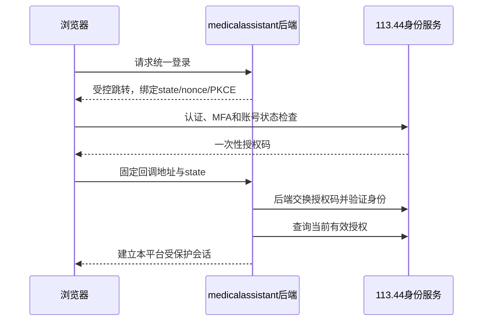

# 113.44 与 medicalassistant 统一身份及授权契约

> **2026-11-08 决策更新：**113.44 负责统一账号身份和账号状态；康复系统继续管理自己的角色、患者及功能权限。管理员逐个核实并绑定已有账号，绑定后保留经审核的康复权限，不按用户名自动绑定。问卷业务及其数据仍由问卷系统授权。本文下方早期草案中要求由 113.44 统一管理康复业务基础授权的内容已被此决策取代，不能作为实现依据。现有问卷账号保留原密码，首次统一登录须重新验证；未知的历史密码强度不视为已通过新密码策略。正式切换仍以线上兼容迁移及验收为前提。

- 日期：2026-11-07（Asia/Singapore）
- 状态：供架构评审的契约草案；协议选型、域名、时限和机构审核责任尚待确认。
- 对应任务：[开发计划](./development-plan-2026-11-07.md) AUTH01—AUTH05、API02、API06、DATA01、DATA03、EMB01—EMB02、MC02。
- 实现状态：本文提出的身份提供接口、嵌入会话和跨平台失效协议尚未实现或验收。本轮未修改113.44线上、账号、表单或患者数据。

## 1. 已确认边界

1. 113.44 是账号、凭据、机构、项目成员、中心归属及基础授权的唯一管理来源；medicalassistant 不再建立第二套可独立注册、改密或赋予中心成员权限的账号体系。
2. 医护通过中心邀请，或申请后由有权限的中心管理员审核。注册成功、邮箱验证、填写机构名均不能直接获得医护身份、签署权或患者数据访问权。
3. 患者可注册统一账号；核实本人或合法代办关系后，才可关联患者档案和项目受试者。账号注册、患者关联和项目入组是三个不同动作。
4. 表单定义、原始答卷和评分由113.44负责；medicalassistant嵌入授权填报入口，管理康复业务、随访任务和医护待办。
5. medicalassistant可以保存最小必要的身份投影、经授权的业务数据及历史引用，但本地不能扩大113.44授予的资源范围。统一账号不改变数据驻留，不自动授权跨中心共享或科研训练。

## 2. 代码基线与缺口

以下为本地代码核查，不作为113.44线上当前部署状态的证明；实施前需复核实际版本及配置。

| 现有能力 / 问题 | 代码入口 | 对本契约的影响 |
|---|---|---|
| 登录有账号状态、验证码、限流及MFA相关流程 | 问卷系统 `app/routes/auth.py:164` | 复用既有认证控制，不绕过MFA、改密和停用状态 |
| 注册有邮箱验证码和普通账号创建，但按输入机构名关联或新建机构 | 问卷系统 `app/routes/auth.py:329` | 新康复注册路径必须进入申请/审核；不能把机构名当成员资格 |
| User全局角色为平台/机构管理与普通研究用户 | 问卷系统 `app/models/user.py:13` | 不将研究者、CRA/CRC直接映射为医生/患者或临床签署资格 |
| 项目成员有角色、中心、表单范围、有效期、指派及撤销 | 问卷系统 `app/models/project.py:193`、`app/routes/project.py:837` | 可复用授权基础，但邀请接受和申请审核需单独建设 |
| Subject关联项目、患者和中心；Patient区分全局身份与机构档案 | 问卷系统 `app/models/project.py:412`、`app/models/patient.py:7` | 账号不等同Patient；需新增经过核实的账号—患者关系 |
| 部分中心权限逻辑允许未分中心数据 | 问卷系统 `app/services/project_permission_service.py:231,756,773` | 新集成协议采用默认拒绝/待核实语义；不得照搬为跨中心可见 |
| 项目填报依赖current_user；安全头默认限制跨站嵌入 | 问卷系统 `app/routes/questionnaire/views_main.py:1000`、`app/services/application_security.py:155` | 必须建设可识别真实操作者的受控嵌入会话；不全站放开iframe |
| 康复平台仍有本地密码注册、登录、模拟快速登录和用户初始化 | `backend/app/api/routers/user_router.py`、`backend/app/services/user_service.py`、`frontend/src/store/slices/authSlice.ts` | 上线统一身份时须同时关闭旁路，不允许只把注册按钮换成链接而保留可调用的本地注册API |

本地未发现113.44作为medicalassistant身份提供方的完整OIDC发现、授权、令牌及授权内省能力。已有微信OAuth属于113.44作为第三方登录客户端，不能当作它已能向medicalassistant提供统一登录。

## 3. 主体模型与权威归属

### 3.1 四类身份必须分开

| 主体 | 稳定标识建议 | 权威来源 / 约束 |
|---|---|---|
| 登录账号 | `issuer + subject`，subject为不重新分配的源账号标识 | 113.44；邮箱、手机号、姓名只作可变属性，不作跨系统唯一键 |
| 临床患者 | `source_system + patient_reference` 与本地patient_id映射 | 由D02确定建档主责，映射必须有核实记录 |
| 项目受试者 | `source_system + project_id + subject_id` | 113.44；同一患者可有多个项目受试者关联 |
| 系统客户端 | `client_id`及环境 | 独立机器身份，限定接口和项目/中心/用途；不能成为患者或医护的替身 |

现有113.44的Subject还可能是筛选中、已入组、已退出或已完成；这些状态不能压缩成“已绑定患者”。绑定、项目状态与具体业务授权都需校验。

### 3.2 拟建数据结构

| 所在端 | 模型 / 投影 | 必需内容 |
|---|---|---|
| 113.44 | `ClinicalIdentityApplication` | 用户、申请身份、机构/中心/项目、待审/通过/拒绝/撤回、审核人、理由、证据引用及版本 |
| 113.44 | `ClinicalMembershipInvitation` | 一次性邀请凭证的hash、邀请人、指定中心/项目、拟授范围、被邀请主体约束、有效期、接受/撤销/过期状态 |
| 113.44 | `AccountPatientLink` | 账号、患者、本人/监护/代办关系、核实状态/方式/责任人、范围、有效期、撤销及历史 |
| 113.44 | `ClinicalCapabilityGrant`或现有成员模型的合规扩展 | 经审核的临床身份和动作范围，不用全局User.role容纳全部临床角色；与既有研究角色共存 |
| 113.44 | `IdentityClient/Grant`、`IdentityChange`、`EmbedSession` | 系统授权、账号及授权版本变化、可撤销的短期嵌入上下文 |
| medicalassistant | `ExternalPrincipal` | issuer、source_subject、本地业务actor_id、源账号状态、最小显示属性、同步时间 |
| medicalassistant | `AuthorizationProjection` | 权威授权ID/版本、资源范围、动作、用途、有效期、上次核验和新鲜度状态 |
| medicalassistant | `ExternalPatientLink` | 源患者/受试者与本地患者的映射、核实状态和历史；不能由前端自行声称关联 |
| medicalassistant | `ApplicationSession` | 本地会话ID、源用户/源会话引用、授权版本、过期和撤销状态；不保存113.44密码 |

源用户标识删除或停用后不得重新赋给另一人。本地actor_id应保留既有业务记录的引用，不以重建Mongo用户来静默改变历史签署主体。

## 4. 注册、入组与审核状态

### 4.1 普通账号注册

medicalassistant显示统一注册入口，由113.44实际处理账号创建及凭据。注册来源、返回地址、申请意图均由服务端验证，不接受任意回跳URL。注册成功后返回“账号已创建/待身份核实”状态；未获得业务授权的账号仅可查看本人申请状态、必要的账号管理和核验入口。

现有注册可能自动关联机构和生成研究表单副本。康复注册实施前须确定兼容方案：新增明确的注册用途和后续申请流程，避免默认复制研究业务权限；同时不破坏既有研究者注册。任何历史注册迁移需先演练，不能把原机构关联自动升级为临床中心授权。

### 4.2 医护邀请与申请

```text
申请：draft → submitted → approved / rejected / withdrawn
邀请：issued → accepted / revoked / expired
临床成员授权：active → suspended / revoked / expired
```

- 邀请由对该中心/项目有明确管理权限的人发起，权限不能超过邀请人可授范围；邀请链接不是匿名授予医护角色的万能入口。
- 被邀请人登录或注册统一账号，并完成邀请主体校验。邀请凭证一次消费，绑定客户端、用途及拟授范围；原始凭证不记录到日志。
- 申请审批人与申请人分开，核验要求、可审批角色及身份材料由D02确认。审批或接受与成员授权创建、授权版本递增及事件写入在同一事务中完成。
- 用户可同时具有已批准的研究与临床身份，不允许“选择医生”直接改写全局角色。签署资格需要独立动作授权。
- 重复申请、重复接受和并发审批应幂等；修改拟授范围后必须重新确认，不复用旧邀请。

### 4.3 患者和代办

```text
未关联 → 待核实 → 已核实关联 → 暂停 / 撤销 / 到期
```

Patient.created_by是建档操作者，不代表患者本人。本人和监护/代办各有明确关系及范围。核实前不显示“候选患者”敏感列表，也不按姓名、证件号片段或手机号自动完成绑定。核实材料、责任人及争议处理由D02确认。

关联成功不自动入组。项目资格、中心归属、入组状态和表单授权仍需满足原有业务规则。多个中心存在档案时，登录账户关联同一患者不意味着有权查看全部中心档案。

## 5. 登录协议与会话建议

本契约推荐使用有成熟实现支持的OIDC授权码流程与PKCE，medicalassistant后端作为机密客户端/BFF；113.44提供身份，或在其受控身份域内提供标准协议适配。协议与实现库在D11评审及技术验证后冻结，本文不声称现有系统已支持OIDC，也不要求自行编写认证/密码学协议。



要求：

- 登录和注册认证页面优先采用顶层受控流程，具体体验由D04确认；表单在平台内嵌入的目标不等于必须把账号密码页面也放进跨站iframe。
- 采用精确的已登记回调地址、state、nonce、PKCE和一次性授权码；验证issuer、audience、签名、算法白名单、有效期、nonce和授权码绑定，拒绝错误环境/客户端令牌。协议库负责标准细节。
- 浏览器只持有本平台的安全会话Cookie；访问/刷新令牌存后端，设置Secure、HttpOnly和适合部署拓扑的SameSite，并进行CSRF防护。避免把服务令牌或完整权限放入localStorage、URL或postMessage。
- 用户ID来自已验证的身份结果，不接受前端传入任意`actor_id`。受信代理头只在受控代理路径使用，不能由外部HTTP头伪造主体。
- 源认证成功仍须查询当前授权；ID Token证明身份，不能单独代表临床资源授权。MFA/认证时间要求按具体高风险操作确认。
- 本地退出、113.44全局退出、账号停用分别定义，销毁相关本地会话并使未完成嵌入会话失效。全局退出能力未验证前，不向用户宣称退出一站即退出全部。
- 身份源不可用或授权状态过旧时，受保护操作按冻结策略拒绝，不回退到本地密码、演示token或绕过认证。

协议依据：[OAuth安全最佳实践RFC9700](https://www.rfc-editor.org/rfc/rfc9700.html)要求精确回调地址等防护；[OIDC Core](https://openid.net/specs/openid-connect-core-1_0.html)定义身份声明及验证。实现前按选定库的实际版本复核标准支持。

## 6. 授权判定与中心语义

每个受保护操作均执行：

```text
有效客户端 ∩ 有效账号 ∩ 经核实的临床身份/患者关系
∩ 当前项目和中心授权 ∩ 具体患者/档案/受试者范围
∩ 临床动作规则 ∩ 使用目的 ∩ 资源当前状态
```

诊疗访问、表单填报、患者自属访问、临床签署、研究数据准备和训练是不同动作或用途。中心管理员、机构管理员、CRA/CRC、系统管理员不能未经确认自动取得医生签署资格。角色—临床动作映射须显式版本化并经业务确认。

范围对象至少包含`project_id`、`center_id`、`questionnaire_family/version或form_id`、`subject/patient范围`、`actions`、`purpose`、`valid_from/until`、`grant_id/version`。身份和授权查询不得默认返回所有机构/患者清单。

新集成接口默认拒绝未分中心或上下文冲突记录。源数据需分别保留患者归属中心、答卷采集中心、当前管理中心及历史访问依据；转中心不是批量改写历史来源或自动共享历史档案。现有“空中心兼容”与平台管理授权必须单独审查，不能作为中心级客户端的宽权限旁路。

### 6.1 临床主体契约样例

以下为字段语义示例，不是真实数据或现有返回格式：

```json
{
  "issuer": "<configured-identity-issuer>",
  "subject": "<stable-source-account-id>",
  "account_status": "active",
  "identity_version": 7,
  "authorization_version": 12,
  "clinical_identities": [
    {"type": "practitioner", "verification_status": "approved"}
  ],
  "grants": [
    {
      "grant_id": "<source-grant-id>",
      "project_id": "<project-id>",
      "center_id": "<center-id>",
      "actions": ["care.patient.read", "forms.fill.on_behalf"],
      "purpose": "clinical_care",
      "valid_until": "<UTC-ISO8601-timestamp>"
    }
  ],
  "checked_at": "<UTC-ISO8601-timestamp>",
  "valid_until": "<UTC-ISO8601-timestamp>"
}
```

action名称由API01冻结；客户端不得自己添加动作。患者的本人/监护关系通过按资源授权的接口查询，避免在登录身份令牌中附带患者明细或完整关系图。

## 7. 嵌入表单及操作人委托

113.44应提供独立的嵌入会话入口；创建会话并不意味着继承普通浏览器管理员会话。会话请求由medicalassistant后端发出，使用独立客户端凭证及可验证的操作人委托上下文，113.44再次校验全部资源范围。

会话记录必须绑定：`client_id`、`source_actor`、`actor_session/授权版本`、`fill_mode`、`project_id`、`center_id`、`patient/subject_id`、`form_id/family/version/definition_hash`、`visit`、`followup_task_id`、`allowed_parent_origin`、有效期、nonce及状态。

`fill_mode`明确区分`self_fill`与`practitioner_on_behalf`，必要时另有经核实的guardian模式。源端提交答卷记录真实操作者、患者、代填关系和来源客户端；不得将服务账号记录为患者本人。前端不能通过修改请求中的actor或patient替换上下文。

进入流程：

1. medicalassistant读取真实任务与当前授权，向113.44申请短期会话，重复请求带幂等键。
2. 浏览器获取仅用于本次启动的短期不透明入口；不在URL放患者身份资料或长期Bearer令牌。若一次性启动码经过URL，应立即消费并跳转到无码地址，日志和Referrer不得泄露该码。
3. 113.44将入口交换为受限的嵌入会话，按固定患者/表单/访视执行保存、草稿恢复和提交；一般管理页面不因会话而开放。
4. 表单发送最小状态消息，父页面验证`origin`、`source`、会话与任务关联；后端从113.44确认真实答卷和状态，消息不能直接结束随访或批准方案。
5. 会话到期、账号停用、授权变化、源退出或任务取消时撤销；切换患者必须创建新会话，不能沿用旧iframe上下文。

会话状态建议为`issued → consumed/active → submitted/expired/revoked`，草稿状态独立保存于答卷。一次性启动不妨碍合法的刷新或草稿恢复：恢复由仍有效的绑定会话进行，不能再次消费旧启动码。多标签页和并发提交需有明确冲突策略。

嵌入部署需要先做实际域名技术验证：同域反向代理与同站子域是不同安全边界，选型须同时评估Cookie、源隔离、CSRF、路径重写和代理可信配置；同站子域不能随意共享父域Cookie。独立跨站iframe还需验证Storage Access等浏览器机制，不能只依赖`SameSite=None`。Safari限制参见[WebKit说明](https://webkit.org/blog/10218/full-third-party-cookie-blocking-and-more/)。仅受控嵌入路由设置允许的`frame-ancestors`等响应头，保留原管理页面限制；逐浏览器验证，不以备用新窗口代替正式嵌入验收。

## 8. 拟建接口边界

以下路径为讨论稿。若选择OIDC，标准认证端点及发现文档依协议实现的元数据声明，不将自定义接口冒充标准OIDC。

| 端点 / 能力 | 调用方 | 语义与约束 |
|---|---|---|
| 标准身份提供端点、客户端注册与密钥轮换 | medicalassistant后端 / 运维 | 使用成熟协议实现；固定issuer、audience、回调和环境；不公开动态授予任意客户端 |
| `GET /integration/v1/identity/principal` | 后端持有效操作人委托 | 最小源身份、状态及版本；不能任意枚举用户 |
| `POST /integration/v1/authorization/check` | 两端业务服务 | 指定actor、action、resource、purpose；返回allow/deny、版本、核验时刻和失效时间；不把客户端声明当事实 |
| `GET /integration/v1/identity/changes?cursor=...` | 获准订阅的客户端 | 账号/成员/授权失效控制流，按客户端曾获授权的引用投递失效；不携带患者内容 |
| `POST /integration/v1/fill-sessions` | medicalassistant后端 | 完成客户端与actor双重校验后建立固定上下文；客户端scope不代替actor权利 |
| `GET /integration/v1/fill-sessions/{id}` | 创建者/授权客户端 | 查询指定任务会话状态及来源答卷引用 |
| `POST /integration/v1/fill-sessions/{id}/revoke` | 有权业务服务 | 取消或撤权后幂等失效；不可撤销无权访问的其他会话 |
| 113.44注册/申请/邀请/核验页面及审批API | 用户 / 获授权审核人 | 真实账号和授权只在113.44写入，申请状态和敏感材料最小化访问 |
| medicalassistant `auth/start/callback/session/logout` | 浏览器与后端 | BFF会话入口；不接收或代理用户密码；CSRF和受控返回地址 |

对状态和授权查询设置`Cache-Control: no-store`；不记录原始凭证、身份证号或核验材料。错误响应采用稳定code和request_id，例如`UNAUTHENTICATED`、`ACCOUNT_INACTIVE`、`IDENTITY_PENDING`、`PATIENT_LINK_UNVERIFIED`、`SCOPE_DENIED`、`AUTHORIZATION_STALE`、`EMBED_SESSION_EXPIRED`、`SOURCE_UNAVAILABLE`。不存在与无权资源的对外响应策略应避免被用于枚举，详细原因仅留在受控审计。

## 9. 授权变化、撤销及离线策略

113.44修改账号/成员/授权时，在同一事务写入身份或授权版本及变更事件。身份变更和答卷变更是独立领域事件，不能仅靠答卷同步推断撤权。

- 账号级：停用、密码/认证会话撤销、全局退出等按冻结规则使本地会话失效。
- 授权级：中心移除、角色变更、到期、患者关系撤销等，失效相应资源范围与嵌入会话；不得扩大为未经批准的其他中心权限。
- 控制流应能向曾持有缓存的客户端通知“失效”，即使其已无权读取资源详情；事件仅给最小引用和版本，防止将撤权详情当成敏感数据旁路。
- medicalassistant保存不可倒退的版本和幂等事件ID；乱序事件不恢复旧权限。游标过期必须重新核验授权后重建投影。
- 本地每次受保护操作均检查账号、授权新鲜度和资源状态；签署、导出、跨中心操作及创建填报会话建议在线核验。允许缓存的具体操作、最大有效期及网络故障策略由D11冻结，未冻结前不得上线默认放行。
- 即使有推送事件，也保留定时核验和恢复对账；本地会话/授权缓存过期后拒绝受保护操作。凭证过期与权限撤销是不同概念，短期JWT本身不能证明即时撤权。
- 撤权对已有临床副本的屏蔽、保留、删除与历史签署凭证按D09确认；至少停止新读取及未经授权的本地访问。保留审计不意味着保留可被所有原用户继续读取的患者数据。

审计应关联`request_id/event_id`、client、真实actor、代填关系、项目/中心、任务/会话及授权版本；签署记录保留当时主体与权限依据。不得仅记录“系统账号操作”。

## 10. 既有账号与业务兼容迁移

1. 先只读盘点medicalassistant现有Mongo用户及其患者、方案、随访、审计引用；区分真实、演示和未知来源，不直接删除或合并。
2. 通过受控核实建立旧本地actor_id到`issuer + source_subject`的映射。禁止按邮箱或姓名自动绑定；不同来源出现同名或同邮箱时进入待处理。
3. 业务actor_id继续保留历史引用，不复制旧密码到113.44，也不把现有本地admin/doctor角色自动升级为源临床授权。患者档案映射与账号映射分别核实。
4. 在隔离环境验证统一入口与旧数据访问，再按正式发布流程切换：同一发布中关闭生产本地密码注册/登录/刷新、模拟快速登录、默认用户初始化及角色直改旁路；旧令牌按冻结策略失效。仅修改前端按钮不能完成切换。
5. 如暂需演示环境，使用明确隔离的环境、数据和客户端配置；生产不能在113.44故障时回退演示身份。紧急运维访问属于D11单独审批、时限和审计的机制，不授予默认临床全权。
6. 回滚只恢复兼容的软件版本和明确开关，不能重开已撤销权限、复活旧临床账号或覆盖新业务记录。用户密码修改、停用、授权撤销等源状态始终以113.44为准。

## 11. 验收契约

| 场景 | 必须结果 |
|---|---|
| 普通账号注册、填写机构名、选择医生身份 | 只能形成待核实申请，不直接获得中心或临床权限 |
| 同一邀请重复/并发接受、过期或被撤销 | 幂等或拒绝；不能产生多份成员授权或恢复旧邀请 |
| 患者未核实、同名/同邮箱、监护或代办关系 | 不暴露候选档案；正确关联与明确关系后按范围访问 |
| 既有研究角色或系统管理员登录 | 不自动得到医生签署、所有患者或科研训练权限 |
| 错issuer/audience、state/nonce、回调或授权码重放 | 拒绝且不建立本地会话 |
| 跨中心猜ID、未分中心、患者转中心 | 符合明确的历史及共享规则，未明确数据默认拒绝 |
| 前端伪造actor、patient、task或postMessage | 后端及113.44再次核验，不能替换填报主体或结束随访 |
| 患者自填、医护代填、多标签页、换患者 | 操作责任、草稿、会话和来源答卷不混淆 |
| iPhone Safari及主要桌面浏览器 | 真实注册/登录、表单嵌入、刷新、提交和恢复；无长期凭证泄露 |
| 账号停用、中心成员移除、角色变化、全局退出 | 旧令牌、会话、授权缓存与嵌入任务在确认时限内失效 |
| 撤权事件乱序/重复、断网和游标过期 | 不恢复旧授权；恢复后对账；无法核验时按确认策略拒绝 |
| 旧本地注册/登录/刷新/模拟快速登录直接调用 | 生产统一身份切换后均不能绕过113.44认证与授权 |
| 诊疗授权的账号或系统客户端请求科研数据 | 没有任务用途授权即拒绝，不默认进入联邦训练 |

每项保留隔离测试和真实浏览器证据，记录身份源/客户端/域名配置及版本；运行与工程验收不替代医护身份真实性、患者关系或机构权限的业务核实。

## 12. 需冻结事项与下一步

| 决策 | 需确认内容 | 冻结前可开展工作 |
|---|---|---|
| D02 | 账号—患者核实、医护审批责任、监护关系、旧账号多身份与患者建档主责 | 数据模型和状态机草案、匿名化样例、负向测试设计 |
| D04 | 域名、是否免重复登录、表单嵌入部署、目标浏览器、退出体验 | 隔离域名/浏览器技术验证，不能先放开生产iframe |
| D09 | 撤权/退出/作废后临床副本与历史签署记录的保留及可见范围 | 状态分离、失效事件、引用和审计设计 |
| D11 | 协议与库、认证强度、缓存最大年龄、变更生效时限、服务不可用策略、紧急运维 | 版本化契约评审、成熟协议实现的能力验证 |
| D06/D07 | 数据驻留、科研用途授权、联邦任务与允许输出 | 保持身份与计算授权分离，不默认集中数据 |

下一步先完成协议及嵌入最小技术验证，冻结身份提供方与依赖方契约，再实现113.44注册审核/授权事件与medicalassistant身份适配。表单内容、评分、原始答卷接口沿用API01—API06另行细化；本契约不定义临床评分或治疗规则，也不宣称已经完成两系统联调。
