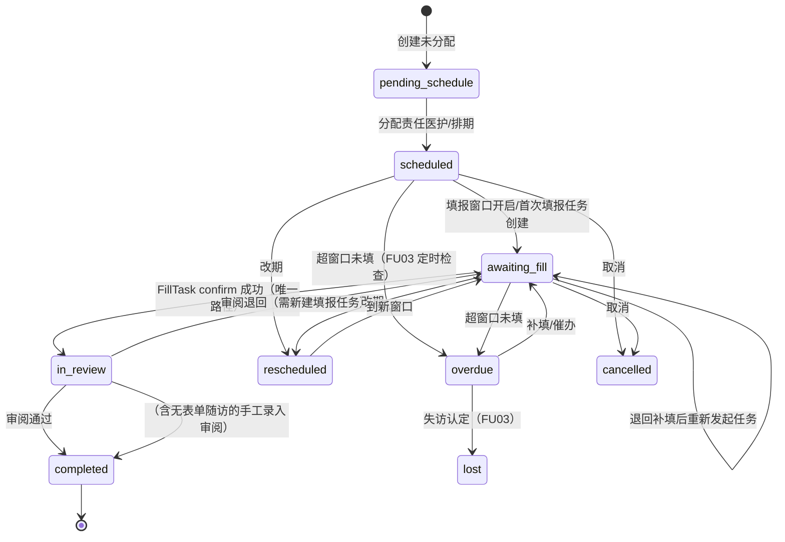
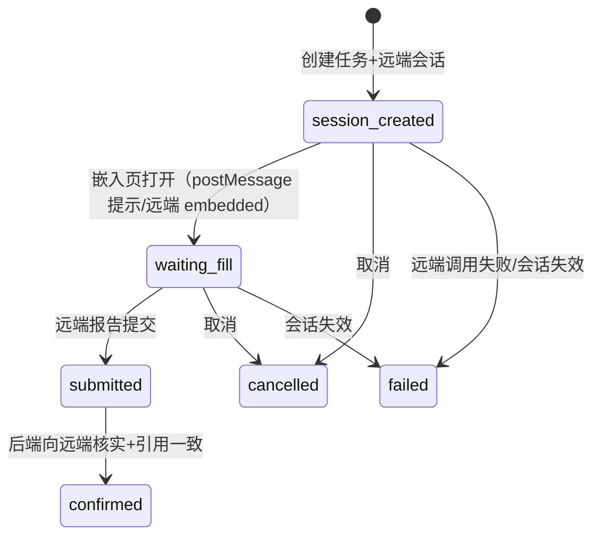
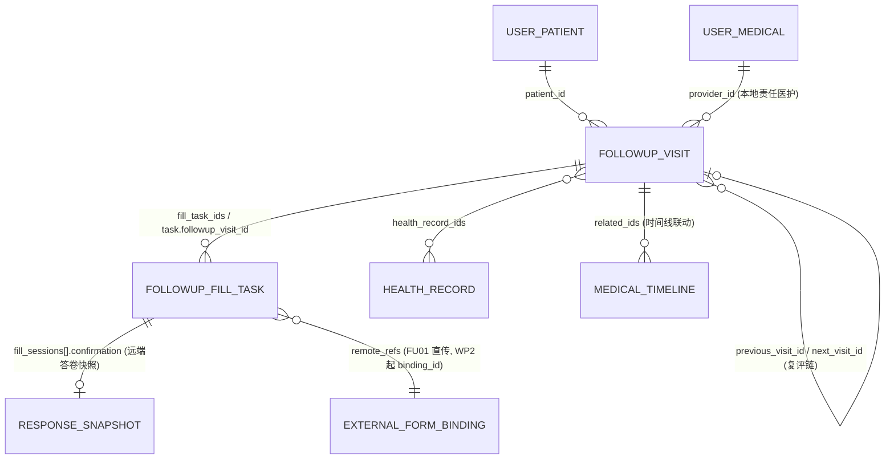

# WP3-FU01 随访领域设计草案：唯一领域服务、节点与状态机、外部表单绑定

- 起草日期：2026-11-07（Asia/Singapore）
- 状态：**设计草案，未实施**。本文只做设计，不修改任何代码；所有「现状」描述基于 2026-11-07 main 分支（1f6c611）工作区，行号以当日工作区为准。
- 依据缩写：
  - 【计划】= docs/development-plan-2026-11-07.md（FU01/FU02/FU03 完成标准见其 WP3 表 ：171-173，状态分离要求见 §5.1 ：241-247）；
  - 【BASE03】= docs/wp0-domain-convergence-analysis-2026-11-07.md；
  - 【试点】= docs/first-integration-pilot.md（首轮隔离联调结论）。
- 与【BASE03】的差异声明：本轮修复提交（023610b 路由遮蔽与 check_permission、e7e8706 服务层对齐生效 schema、5c94557 医生端页面接真实 API）已解决【BASE03】§1.2「预期 AttributeError」与 §3.2「预期 500」描述的问题，本文不再沿用这两类过时结论；集合分裂、两代 schema 并存、并行随访入口等仍是现状，逐条给出 file:line。

---

## 一、现状盘点（设计输入）

### 1.1 存储与 schema

| # | 现状 | 位置 |
|---|------|------|
| 1 | 存储模型 `FollowUpRecord` 为第一代文档结构（`patient_id/created_by/notes/questions/answers/health_record_ids`），集合 `followup_records` | backend/app/models/health_record.py:123-229（集合名 ：125） |
| 2 | API 契约为第二代（`provider_id/description/related_records/template_id/completion_data` 等），13 组同名模型中后定义生效 | backend/app/schemas/health_record.py:465-555（覆盖关系见【BASE03】§1.1 表） |
| 3 | 服务层已按生效 schema 修正字段访问，但靠「缝合层」把第一代存储适配到第二代响应（`description→notes`、`provider_id=created_by` 等） | backend/app/services/health_record_service.py:351-361、425-444、1091-1130 |
| 4 | `completion_data/cancellation_data/next_follow_up_id/template_id` 等第二代字段以 `metadata.*` 顶层规避方式落库（写入 `metadata` 以避免 `from_mongo` 报 TypeError） | backend/app/services/health_record_service.py:515-528、605-612、547-551 |
| 5 | 随访状态枚举两套拼写：schema `canceled`，存储模型注释与方法用 `cancelled`；`cancel_followup` 在提供 `reschedule_date` 时把状态改成 `rescheduled` 而非 `cancelled` | backend/app/schemas/health_record.py:39-44；backend/app/models/health_record.py:134、204-215 |
| 6 | 造数脚本写 `follow_ups` 集合，字段为 `title/content/doctor_id/doctor_name/completed_date`，与服务端写入形状完全不同 | backend/mock_data_scripts/create_test_health_records.py（写 `follow_ups`，【BASE03】§2.1、§4.1 表） |
| 7 | 状态机只有 `scheduled/completed/canceled/missed/rescheduled`；`complete` 直接置 `completed`，**没有「待审阅」环节** | backend/app/schemas/health_record.py:39-44；backend/app/services/health_record_service.py:518-529 |

### 1.2 路由与服务入口（并行重复入口仍是现状）

| 入口 | 现状 | 位置 |
|------|------|------|
| `/api/health-records/followups`（POST/GET/PUT/complete/cancel/reschedule/upcoming） | 真实链路，走 `HealthRecordService`，是事实上的主入口 | backend/app/api/routers/health_record_router.py:197-428 |
| `/api/doctors/follow-ups` GET | 直连 `db[FollowUpRecord.collection_name]` 按 `created_by` 查询，**绕过服务层**，返回原始 dict（无响应契约） | backend/app/api/routers/doctor_router.py:162-199 |
| `/api/doctors/follow-ups` POST | **仍返回假 ID** `{"id": "new_follow_up_id"}`，不写库 | backend/app/api/routers/doctor_router.py:201-210 |
| `/api/health-managers/follow-ups` GET/POST | 占位实现（空列表/假 ID） | backend/app/api/routers/health_manager_router.py:32-52（【BASE03】§3.3） |
| 医生端前端页面 | 已改为调用 `apiService` 真实接口（`/health-records/followups`），纯模拟数据已移除 | frontend/src/services/api.ts:280-296；frontend/src/pages/Doctor/FollowUpManagement.tsx（提交 5c94557） |

即：**「无假 ID 和并行重复随访入口」（【计划】FU01 完成标准 ：171）目前不满足**——`doctor_router.py:201-210` 的假 POST 与 `health_manager_router.py:32-52` 的占位仍在，且 `doctor_router.py:162-199` 构成第二条读取路径。

### 1.3 试点 IntegrationFillTask（外部表单绑定现状）

- 模型为**试点隔离**的 dict 驱动类，集合 `integration_fill_tasks`（backend/app/integrations/forms/models.py:27、34-125）；文件头自述「后续随访领域模型收敛时迁移（FU01/FU02 不在本轮）」（:4）。
- 任务状态机已在真实浏览器端到端验证：`session_created → waiting_fill → submitted → confirmed`，终态 `cancelled/failed`（models.py:6-25；【试点】：26）。
- 已带 `ma_task_ref/visit_code/visit_name` 关联字段（models.py:65-66），创建时透传给远端会话（service.py:136-143）。
- 确认证据结构：`response_id/session_uuid/remote_status/visit_code/submitted_at/answers/verified_at`（service.py:256-264），且确认前做远端引用一致性核验（`RESPONSE_MISMATCH`，service.py:240-254；【试点】：31）。
- 前端 `postMessage` 仅作刷新提示，伪造消息四类全部被忽略（【试点】：32）；确认一律以后端向 113.44 查询为准。
- **试点隔离库已清理**：`rehab-pilot-mongo` 容器与 `rehab_pilot` 库已删除，主开发库未被试点写入（【试点】：47）→ `integration_fill_tasks` 集合在主库**没有历史数据**，模型归位不涉及数据迁移。

### 1.4 集合迁移脚本现状

- `backend/scripts/migrate_legacy_collections.py` 已把 `follow_ups → followup_records` 列为复制方向，enrich 仅补 `created_by ← doctor_id` 别名（:26-31）；行为约束为只复制不删除、幂等、默认 dry-run（:6-10）。
- 该脚本**没有做字段级映射**：`follow_ups` 中造数形状文档（`title/content/doctor_id/completed_date`）复制进 `followup_records` 后，既缺 `patient_id/created_by`（仅补后者）也缺 `scheduled_date/status`，会被列表查询过滤掉但仍是脏数据（【BASE03】§5.2.2 明确「合并需要字段级映射脚本，而不是改名了事」）。

---

## 二、唯一随访领域模型设计

### 2.1 对象划分：节点（访视）/ 填报任务 / 答卷来源 / 审阅记录

【计划】FU01 要求「任务与答卷状态分别建模」（:171），§5.1 要求「随访业务：待安排 → 待填写 → 待医护审阅 → 已完成」与「远端答卷：按113.44真实状态建模」（:243-244）。据此拆四个对象，各自独立生命周期：

#### ① 随访节点 FollowUpVisit（业务主对象，承载现有 FollowUpRecord 升级）

一次随访安排 = 一个节点。在现有 `FollowUpRecord` 文档结构上**扩展**而非另建集合（理由见 §2.4），新增字段：

| 字段 | 类型 | 说明 |
|------|------|------|
| `visit_code` / `visit_name` | str / str | 与 113.44 访视关联的编码；嵌入填报时透传（机制已存在，integrations/forms/service.py:136-139） |
| `provider_id` | str | 责任医护（正式字段，替代「`created_by` 兼职 provider、`provider_id` 塞 metadata」的缝合做法，health_record_service.py:356-357、1106） |
| `assigned_by` / `assigned_at` | str / datetime | 分配人与时间（审阅证据链起点） |
| `form_binding` | object | `{binding_id?, use, questionnaire_id, form_version, definition_hash}`；FU01 阶段先存 `remote_refs` 直传值，WP2 的 `ExternalFormBinding`（【计划】§WP2 拟建模型 ：156）落地后升级为 `binding_id` 引用 |
| `fill_task_ids` | List[ObjectId] | 关联填报任务反向索引（1..N，多次填报全保留，【计划】§5.1 :246） |
| `effective_response` | object | 按有效答卷规则选定的 `{task_id, response_id, revision, submitted_at}`；无表单随访（如电话）为 null |
| `review` | object | 审阅证据链，结构见 §4.3 |
| `previous_visit_id` / `next_visit_id` | ObjectId? | 复评/后续随访链（替代 `metadata.next_follow_up_id`，health_record_service.py:547-551） |
| `visit_seq` | int | 患者内访视序号（同一患者第几次随访，便于 CLIN02 纵向展示） |

保留字段：`patient_id`、`follow_up_type`（对齐 `FollowUpType` 枚举，schemas/health_record.py:28-35）、`scheduled_date`、`actual_date`、`questions`、`health_record_ids`（正式化为存储字段，终止 `related_records→health_record_ids` 改名缝合）、`notes`、`reminder_settings`。

#### ② 填报任务 FollowUpFillTask（IntegrationFillTask 收敛归位）

职责：一次「嵌入 113.44 填报」的协议对象——远端会话、一次性令牌、确认证据。状态机**原样保留试点验证过的六态**（models.py:6-25），不并入节点状态机（见 §2.2 的分离规则）。字段映射与归位路径见 §三。

#### ③ 答卷来源 ResponseSource（不建独立集合、不建本地状态机）

【计划】§5.1 :244「远端答卷按113.44真实状态建模」+ A01「medicalassistant 不再维护平行的表单定义和评分引擎」（:22）。因此：

- 本地**不**复刻答卷状态机；每次任务 confirm 时把远端返回的 `remote_status`（draft/submitted/voided/restored 等）、`revision`、`definition_hash`、逐题答案快照进 `fill_task.fill_sessions[].confirmation`（复用试点 evidence 结构，service.py:256-264）。
- 有效答卷规则（【计划】§5.1 :246-247）：已提交、未作废、在授权范围内、取最新修订；同一节点多次填报的来源全部保留，选定结果记入 `visit.effective_response`，选择依据可追溯。
- 答卷修订/作废传播属于 WP2 DATA03（【计划】：151），FU01 只保证证据快照含修订号，使后续重算/失效有据可依（呼应【计划】§5.2 :251）。

#### ④ 审阅记录 ReviewRecord（先内嵌，不独立建集合）

审阅是节点上的事件序列而非独立领域对象（单节点审阅次数有限），以 `visit.review` 内嵌 + 历次记录数组实现；若 FU02 实施中发现需要独立查询（如「我审阅过的」工作台），再拆集合。结构见 §4.3。

### 2.2 状态机设计

#### 节点状态机（随访业务状态，对齐【计划】§5.1 :243）



- 枚举扩展：现有 `FollowUpStatus`（schemas/health_record.py:39-44）增加 `pending_schedule`、`awaiting_fill`、`in_review`、`lost`（失访）；`missed` 与 `overdue` 的拆分（「逾期可补救」vs「失访终态」）属于 FU03 口径，**FU01 先保留 `missed` 不删、新增 `overdue`/`lost` 并标注待 FU03 确认后收敛**（依据：【计划】FU03 :173「依从性计算口径和重复提醒规则明确」）。
- 拼写统一：全部采用 schema 现有拼写 `canceled`（schemas/health_record.py:42），存储模型 `cancel_followup` 的 `cancelled` 写法（models/health_record.py:206）在切片 S2 中归一；迁移脚本对 `follow_ups` 复制文档同步映射（§2.4）。
- 现有缺陷修正：`cancel_followup` 带 `reschedule_date` 时把状态改成 `rescheduled`（models/health_record.py:211-213）与「取消」语义冲突；新状态机中取消 + 改期 = 关闭当前节点（`cancelled`）并**新建节点**（`previous_visit_id` 关联），不在同一节点上改状态。

#### 填报任务状态机（保持试点状态机不变）



**任务状态与节点状态的耦合规则（「已提交仅转待审阅」的建模基础）：**

| 任务事件 | 节点反应 | 依据 |
|----------|----------|------|
| 任务创建成功（`session_created`） | 节点 `scheduled → awaiting_fill` | 节点「待填写」以存在有效填报会话为准 |
| 任务 `submitted` | **节点不变**（仍 `awaiting_fill`） | 远端提交未经本地核实不算数（【计划】§5.1 :245；【试点】：32） |
| 任务 `confirmed` | 节点 `awaiting_fill → in_review`，写 `effective_response` | **唯一**转待审阅路径 |
| 任务 `cancelled`/`failed` | 节点回 `awaiting_fill`（如无其他进行中任务）或保持 | 失败如实记录，不伪装（【试点】service 头注 :6） |
| 审阅退回 | 节点 `in_review → awaiting_fill`，旧任务保持 `confirmed` 终态，需**新建**任务重填 | 一次性令牌用后作废（【试点】：29），续填即新任务 |

与【计划】§5.1 :243 的「待填写 → 待医护审阅」对应关系：`awaiting_fill` = 待填写，`in_review` = 待医护审阅；`submitted` 只是任务内部状态，不出现在节点业务状态中，避免「已提交但未核实」被前端当成待审阅展示。

### 2.3 关系模型



- **患者**：`patient_id` 指向 `users` 集合中 `role=patient` 的文档（试点患者归属校验已按此实现，integrations/forms/service.py:59-62）；`patients/doctors` 分裂集合为迁移脚本 REPORT_ONLY（migrate_legacy_collections.py:46-51），随访模型只认 `users`。
- **医护**：本地责任医护用本地 `users` ID（`provider_id`）；远端操作者用 `remote_refs.remote_operator_user_id` 显式传入，**不做自动映射**（试点模型注释，integrations/forms/models.py:50；【试点】代填审计要求 ：17）。分配校验复用 `practitioners` 主治医生机制（service.py:65-76），默认拒绝。
- **外部表单绑定**：FU01 阶段 `form_binding` 存创建任务时直传的 `remote_refs`（project/center/subject/questionnaire 整数 ID，service.py:79-92）；D03 确认正式表单与版本后（§六 D-1），WP2 `ExternalFormBinding` 建立后升级为 `binding_id` + 版本锁引用，届时同一问卷 ID 不同版本的节点各自锁定版本（A06 版本可追溯，【计划】：27）。

### 2.4 集合与 schema 命名（唯一集合名原则）

| 领域对象 | 建议唯一集合名 | 现状与理由 |
|----------|----------------|-----------|
| 随访节点 | **`followup_records`** | 迁移脚本已选定 `follow_ups → followup_records` 复制方向（migrate_legacy_collections.py:27-31）；服务层读写已全部走此集合（health_record_service.py:33）。改名为 `followup_visits` 需再迁一轮且无业务收益，**保持现名、文档内承载节点语义**。`follow_ups` 迁移后保留待人工处置（脚本既有约束 ：9-10） |
| 填报任务 | **`integration_fill_tasks`** | 集合名经常量 `COLLECTION_NAME` 收敛，是【BASE03】§2.2 认可的范本（:110）；主库无历史数据（【试点】：47），改名无数据成本但会牵动试点已验证的 service/router 代码，收益低，**保持现名** |
| 答卷快照 | FU01 不建集合（内嵌于任务文档） | WP2 `ExternalResponseSnapshot`（【计划】：156）落地后外置；届时把 `fill_sessions[].confirmation` 引用升级为快照 ID，旧内嵌证据保留（A06） |
| 审阅记录 | 内嵌于节点文档（`visit.review.history[]`） | 见 §2.1 ④；FU02 若需独立查询再拆 |
| 时间线 | `medical_timelines` | 现状引用一致（【BASE03】§2.2 :98） |
| 废弃 | `follow_ups` | 脚本复制完成后冻结写入；造数脚本同步改写 `followup_records`（【BASE03】§5.2.5 :216） |

schema 命名：以第二代骨架（`FollowUpBase/FollowUpRecordDB/FollowUpRecordResponse`，schemas/health_record.py:465-555）为唯一契约，拆出独立文件 `app/schemas/followup.py`（与 §五 S1 切片配套），删除第一代同名定义（【BASE03】§1.1 表 6-11 组）；pydantic v2 风格改写（【BASE03】§5.2.6 :217）。

**与 ⑱ 集合统一任务的衔接**（本节即对「唯一集合名」原则的建议，供集合统一任务采纳）：

1. 迁移脚本 enrich 需从「补别名」升级为「字段级映射 + 打标」，否则 `follow_ups` 造数文档复制进 `followup_records` 后是缺 `patient_id/status/scheduled_date` 的脏文档（§1.4）。建议在复制时统一注入：
   - `legacy_source: "follow_ups"`（标记，便于识别与回滚，不污染业务字段）；
   - `status` 映射：`completed_date` 存在 → `completed`（拼写统一为 `canceled` 一并处理 `cancelled→canceled`）；
   - `scheduled_date` 缺失时以 `completed_date` 回填、`title` 并入 `notes`；
   - 若业务确认造数数据无需保留，则把 `follow_ups` 从 MIGRATIONS 移到 REPORT_ONLY（归档不复制）——**需业务决策，见 §六 D-4**。
2. 节点新增字段（`visit_code/provider_id/form_binding/...`）对存量文档缺省即可（Optional），不需要回填迁移；`created_by` 保留为兼容读取（写入侧改为 `provider_id` 为准）。
3. 唯一服务入口落地后，`doctor_router.py:183`（直连 `db[FollowUpRecord.collection_name]`）必须改为转调服务，纳入「无并行入口」验收（§五 S2）。

---

## 三、IntegrationFillTask → 正式随访模型的迁移路径

### 3.1 结论先行：试点数据零迁移，只需模型归位

- 试点运行在独立 Mongo 容器 `rehab-pilot-mongo` 的 `rehab_pilot` 库，联调后已 `docker rm` 连库销毁；主开发数据库全程未被试点写入（【试点】：22、47）。
- 因此 `integration_fill_tasks` 集合**没有需要迁移的试点数据**；迁移工作 = 模型与关联字段归位 + 服务层接线，不涉及 `migrate_legacy_collections.py`（该脚本管的是遗留业务集合，与填报任务无关）。

### 3.2 字段映射（试点 → 正式模型）

| 试点字段（integrations/forms/models.py） | 正式归属 | 处理 |
|------------------------------------------|----------|------|
| `patient_id`（:48） | FillTask.`patient_id` | 不变；正式化时增加与节点 `patient_id` 一致性校验（confirm 时核对） |
| `operator{user_id, role, remote_user_id}`（:50-54） | FillTask.`operator` | 不变；显式传入不自动映射（试点结论保留） |
| `remote_refs{project/center/subject/questionnaire/remote_operator}`（:56-62） | FillTask.`remote_refs`；节点 `form_binding` 同源记录 | FU01 直传不变；WP2 `ExternalFormBinding` 后节点侧升级 `binding_id` |
| `allowed_origin`（:63） | FillTask.`allowed_origin` | 不变（EMB01 安全校验面） |
| `visit_code` / `visit_name`（:65-66） | FillTask 保留 + **节点新增 `visit_code`** | 成为节点↔任务↔远端访视的关联键 |
| `ma_task_ref`（:66） | FillTask.`ma_task_ref` 保留；**新增正式外键 `followup_visit_id`** | `ma_task_ref` 是试点自由字符串引用，正式模型改为 ObjectId 外键 + 可选 `ma_task_ref` 兼容透传远端（service.py:140-143 不动） |
| `session{session_uuid, embed_token_hash, embed_url, response_id, expires_at}`（:69-75） | FillTask.`fill_sessions[]`（单会话 → 会话列表） | 支持同一任务多次会话/多节点多次填报（【计划】§5.1 :246「同一任务关联多次填报时保留全部来源」）；每次会话独立 token 哈希与过期 |
| `confirmation`（:77） | FillTask.`fill_sessions[].confirmation` | 快照结构不变（service.py:256-264），增加 `revision`/`definition_hash`（WP1 API 契约字段，【计划】：141） |
| `last_error` / `ttl_seconds` / `created_at` / `updated_at` / `confirmed_at`（:78-84） | 同名保留 | 不变 |

### 3.3 模型归位与关联机制

- **归位方案**：`IntegrationFillTask` 更名 `FollowUpFillTask`，**留在 `backend/app/integrations/forms/`**（不搬入业务模型目录）。理由：【计划】§8.1 把 `backend/app/integrations/forms/` 定位为「新建适配、同步和来源管理」位置（:329），任务本质是集成协议对象（embed_token、allowed_origin、远端会话都是协议状态）；业务侧通过 `followup_visit_id` 外键 + 随访服务层唯一入口使用它，避免把协议状态混入随访业务集合（同【计划】：156「避免将所有协议状态混入健康档案 metadata」）。
- **关联机制（复用 ma_task_ref/visit_code 现有机制）**：
  1. 医护在节点上发起填报 → 随访服务创建 FillTask，填 `followup_visit_id`、`visit_code=节点.visit_code`，可选 `ma_task_ref` 透传远端（现有 remote_payload 逻辑，service.py:136-143 不改）；
  2. `confirm_fill_task` 成功（远端核实 + `RESPONSE_MISMATCH` 核验通过，service.py:240-254）后，**新增一步**：按 `followup_visit_id` 回写节点 `awaiting_fill → in_review` + `effective_response`；
  3. 增加核验：远端返回的 `visit_code`（evidence 已含，service.py:260）与节点 `visit_code` 不一致时拒绝确认——防止答卷串访视（与现有 project/subject/questionnaire 核验同级别）；
  4. 无 `followup_visit_id` 的任务（试点遗留调用形态）仍可独立存在（`ma_task_ref` 自由引用），不触发节点状态转换——保持试点 API 向后兼容，FU02 前端切换后由前端固定传 `followup_visit_id`。

---

## 四、FU02 流程设计：创建/分配/嵌入填报/医护审阅/复评

完成标准【计划】：172「已提交仅转待审阅；多次填报和多访视正确关联」。

### 4.1 创建与分配

- 唯一入口：`POST /api/health-records/followups`（现有路由，health_record_router.py:197-219），body 走新 `FollowUpVisitCreate` schema（含 `provider_id`、`visit_code?`、`form_binding?`、`scheduled_date`、窗口）。
- 校验顺序：登录主体 → 角色与权限（沿用 `is_medical_staff` + `check_permission` 修复后的统一写法）→ 患者归属（操作者在患者 `practitioners` 中，复用 service.py:65-76）→ 若带 `form_binding`，校验问卷 ID 在 D03 确认清单内（未确认前拒绝或转待定，见 §六 D-1）。
- 并行入口处置：`doctor_router.py:201-210` 假 POST **删除**（或改转调服务，由 S2 切片验收「响应不再含假 ID」）；`doctor_router.py:162-199` GET 改为转调 `FollowupService.list_visits`（同查询语义，消除直连集合）；`health_manager_router.py:32-52` 占位转调服务。
- 分配：创建时必填 `provider_id`（替代现在 `created_by` 回退逻辑，health_record_service.py:366），写 `assigned_by/assigned_at`；节点状态 `pending_schedule → scheduled`。

### 4.2 嵌入填报

- 医护对 `scheduled/awaiting_fill` 节点发起填报 → 复用试点 `POST /api/integrations/forms/fill-tasks`（integrations/forms/router.py:38），新增必填 `followup_visit_id`；
- 嵌入、一次性令牌、postMessage 刷新提示、后端 confirm 全部沿用试点已验证机制（【试点】：26-32），FU02 前端工作是把嵌入壳接入医生/健康管理师随访页（【计划】EMB02 :153）；
- **已提交仅转待审阅**的实现保证：
  - 前端消息只触发 `confirm` 调用，不直接改节点状态（【试点】：32 已验证伪造消息被忽略）；
  - 节点转 `in_review` 只发生在服务层 confirm 成功路径（§3.3 第 2 步）；
  - 旧 `POST /followups/{id}/complete`（health_record_router.py:342-361）**不得**再直达 `completed`：FU02 起该端点降级为「无表单随访的手工结果录入」，写 answers 与 notes 后节点转 `in_review`（同样要审阅），`completed` 只能由审阅接口置达（§4.3）。此语义变更需临床确认（§六 D-2）。

### 4.3 医护审阅与证据链

- 待审阅工作台：`GET /api/health-records/followups?status=in_review`（现有列表接口加状态即可，health_record_router.py:221-257），响应携带 `effective_response` 与任务确认证据摘要。
- 审阅动作 `POST /followups/{id}/review`（新端点）：

```json
{
  "decision": "approved | returned",
  "comment": "审阅意见",
  "evidence": {
    "task_id": "...", "response_id": "...", "revision": 1,
    "definition_hash": "...", "submitted_at": "...", "verified_at": "..."
  }
}
```

- 证据链字段（`visit.review`）：`history[]` 每次 `{review_id, reviewer_id, reviewer_role, reviewed_at, decision, comment, evidence}`；通过时置 `completed` + `actual_date=reviewed_at`；退回时置 `awaiting_fill` 并要求对下一任务重新发起。审阅人必须是 `provider_id` 本人或有管理权限者（沿用患者归属校验），审计经 audit_log_service 记录。
- 时间线联动沿用现有 `MedicalTimeline.from_follow_up` 写路径（health_record_service.py:383-384、559-568），描述改为审阅结论（「审阅通过/退回」）。

### 4.4 复评与多访视关联

- 复评 = 新节点：`POST /followups/{id}/re-evaluate`（或复用创建接口带 `previous_visit_id`），复制 `form_binding`/`questions`/`follow_up_type`，写 `previous_visit_id`，原节点写 `next_visit_id`——替代现有 `metadata.next_follow_up_id`（health_record_service.py:547-551、637-640），原节点**不覆盖不改写**（A06，【计划】：27）。
- 多访视正确关联的验收口径：同一患者 `visit_code` 各节点唯一；任务 confirm 核验 `visit_code` 一致（§3.3 第 3 步）；`previous/next` 链双向可查；跨访视任务不可互相污染（`effective_response` 只能引用本节点任务）。
- 复评表单版本与时间窗口依赖 D03（【计划】：98 阻塞 FU01/FU02），未确认前复评接口可先实现结构、表单绑定字段留空并标注待定。

---

## 五、实施切片建议（可独立提交/验证，每片带验收标准）

依赖关系：S1 → S2 → S3 → S4 →（S5、S6 可部分并行）。

### S1 随访 schema 收敛（纯后端，无行为变化）
- 内容：拆出 `app/schemas/followup.py`，删除第一代同名覆盖（6 组），pydantic v2 改写；`FollowUpStatus` 扩展新状态；服务层停止 `metadata.*` 顶层数据（`FollowUpRecord` 存储模型补 `provider_id/template_id/reminder_before/completion_data/cancellation_data/next_follow_up_id` 正式字段）。
- 验收：隔离实例上 create/update/list/complete/cancel/reschedule/upcoming 七条集成用例通过；`grep` 确认无第一代字段访问（`notes→description` 类缝合只剩映射函数一处）；`tests/test_object_id_schema.py` 回归门通过（【BASE03】§5.2.6 :217）。

### S2 唯一服务入口与路由收敛
- 内容：新建 `FollowupService`（从 `HealthRecordService` 拆出随访方法组），`doctor_router` GET/POST 转调或删除、`health_manager_router` 转调；`canceled/cancelled` 拼写归一；取消+改期语义修正（§2.2）。
- 验收：`/api/doctors/follow-ups` GET 返回与 `/api/health-records/followups` 同源同形状（带响应契约）；全代码库无 `new_follow_up_id` 假 ID、无路由层直连 `followup_records`/`follow_ups`；`cancel(reschedule_date)` 产生新节点且原节点 `cancelled`。
- 依据：【计划】FU01「无假ID和并行重复随访入口」：171；【BASE03】§5.1 :202。

### S3 迁移脚本字段级映射补齐 + 节点字段增强
- 内容：脚本 enrich 升级（`legacy_source` 打标、status/scheduled_date 映射、拼写归一）；`FollowUpRecord` 增加 `visit_code/provider_id/form_binding/fill_task_ids/effective_response/review/previous_visit_id/next_visit_id`（全部 Optional，存量文档免回填）。
- 验收：dry-run 报告展示映射前后差异；apply 后复制文档含 `legacy_source` 且能被列表接口正常返回；存量文档读取不报错。
- 待决策：造数数据是否值得迁移（§六 D-4）。

### S4 FillTask 归位与节点联动（FU01 核心交付）
- 内容：`IntegrationFillTask → FollowUpFillTask` 更名归位（§3.2 字段映射），`fill_sessions[]` 多会话化，新增 `followup_visit_id`；confirm 成功回写节点 `in_review` + `effective_response` + `visit_code` 核验。
- 验收：任务 `confirmed` 后节点状态为 `in_review` 且 `effective_response` 指向该任务；伪造 postMessage（origin/source/type/结构四类）不改变节点状态（复用试点契约测试基线，【试点】：32）；`visit_code` 不一致拒绝确认（`RESPONSE_MISMATCH` 同级）；无 `followup_visit_id` 任务保持旧行为（向后兼容）。
- 依赖：D03 正式表单清单未确认前，`form_binding` 允许直传试点式 remote_refs（不阻塞本切片）。

### S5（FU02）审阅与证据链
- 内容：`POST /followups/{id}/review` 端点 + `review.history[]` 证据链；complete 端点降级为手工录入转 `in_review`；前端审阅工作台。
- 验收：`completed` 只能由审阅通过产生（ attempting 直接 complete 返回状态机错误）；退回后节点回 `awaiting_fill` 且需新任务；审阅记录含 reviewer/evidence 全链并可追溯。
- 依赖：手工录入语义需临床确认（§六 D-2）。

### S6（FU02）复评链与多次填报
- 内容：`re-evaluate` 端点 + `previous/next_visit_id` 链；有效答卷选择规则实现（已提交/未作废/授权内/最新修订）。
- 验收：多次填报任务全部保留、`effective_response` 选取符合规则且可解释；复评产生新节点不覆盖原节点；跨访视答卷引用被拒。
- 依赖：D03（复评表单版本/时间窗口）。

### FU03 前置说明
- 逾期（`overdue`）定时检查、失访（`lost`）认定、提醒重试与升级属 FU03（【计划】：173），FU01 只保证状态枚举与证据字段就位，不实现调度。

---

## 六、待业务决策清单

| ID | 决策 | 影响切片 | 决策角色（对齐【计划】§3） |
|----|------|----------|---------------------------|
| D-1（=【计划】D03） | 正式初评/复评/随访表及版本、时间窗口；`form_binding` 何时从直传 remote_refs 升级为 `ExternalFormBinding` 引用 | S4、S6 | 临床、表单负责人（【计划】：98 明确 D03 阻塞 FU01） |
| D-2 | 无表单随访（电话/家访）的手工结果录入是否保留、录入后是否同样必须审阅；`complete` 端点降级语义确认 | S5 | 临床（【计划】§5.1 :247「草稿使用须另行明确」同源逻辑） |
| D-3 | `missed` 与 `overdue/lost` 的口径拆分（逾期可补救 vs 失访终态）、失访认定人 | FU03，S1 只占位 | 临床（【计划】FU03 :173） |
| D-4 | `follow_ups` 遗留造数数据是「字段映射迁移」还是「归档不迁移」（脚本 MIGRATIONS → REPORT_ONLY） | S3 | 业务、数据管理员（【BASE03】§5.2.1 :212「先盘点真实库再动代码」——需隔离实例确认主库两集合实际文档数后定） |
| D-5（=【计划】D05） | 答卷字段映射、评分解释与手工覆盖口径（影响 `confirmation` 快照中哪些字段进入本地观察值） | WP2 DATA02 衔接，S4 快照字段预留 | 肾脏康复临床组（【计划】：100） |

以上决策未确认前，各切片按「结构先行、语义待定」实施：字段与状态占位、接口可测，但不把待定语义当作已生效能力（对齐【计划】：12 的声明原则）。
